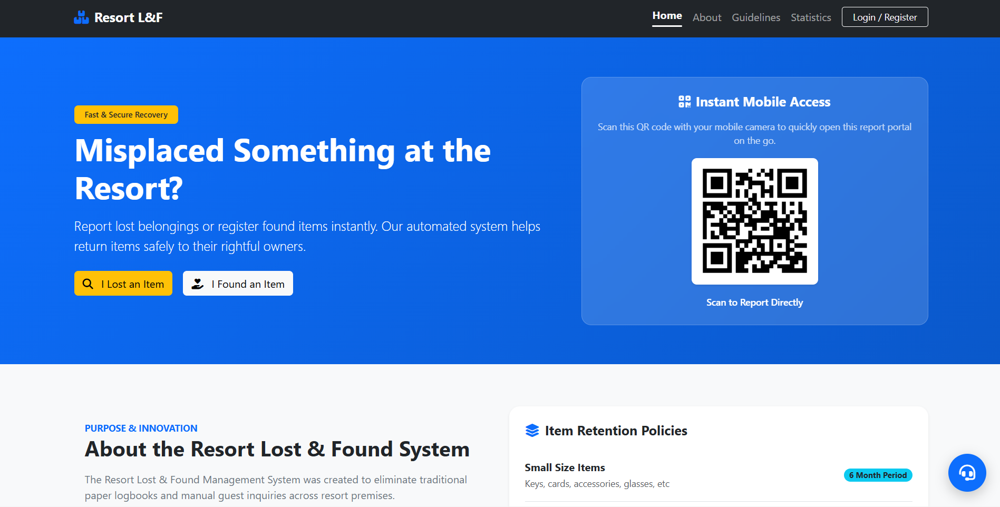
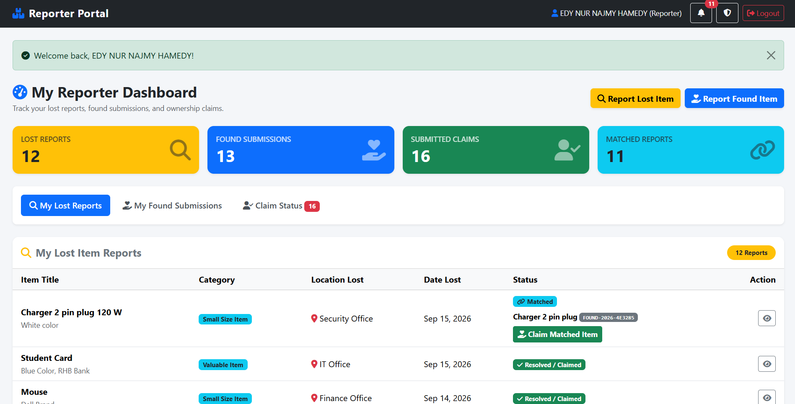
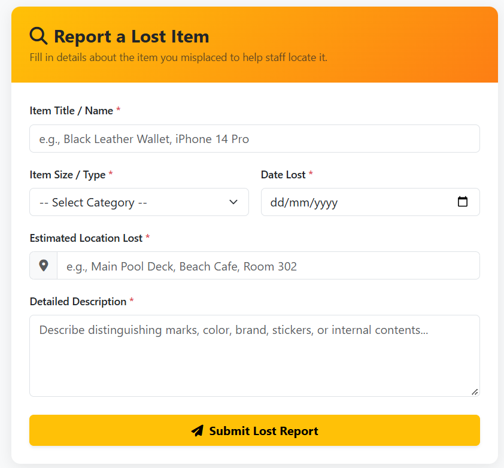
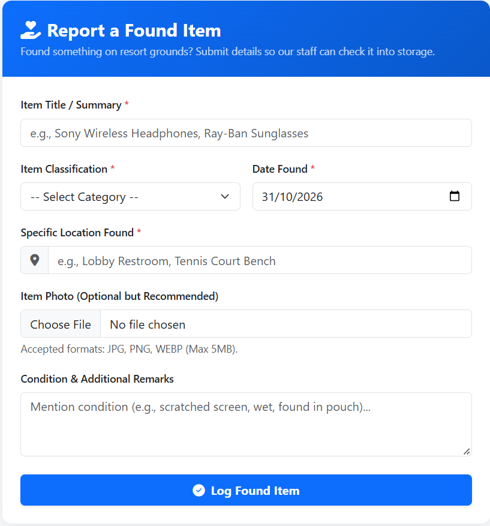
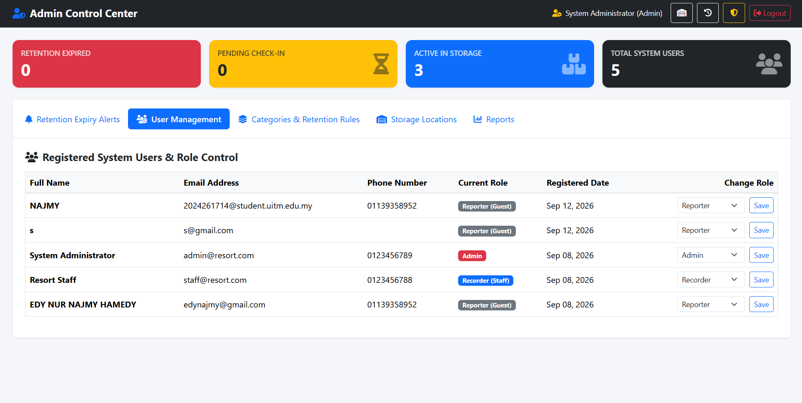
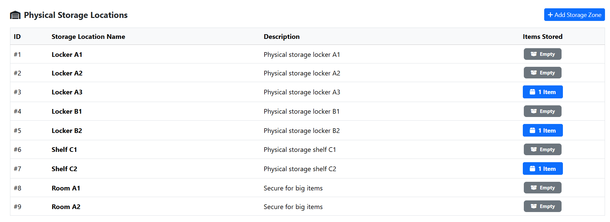
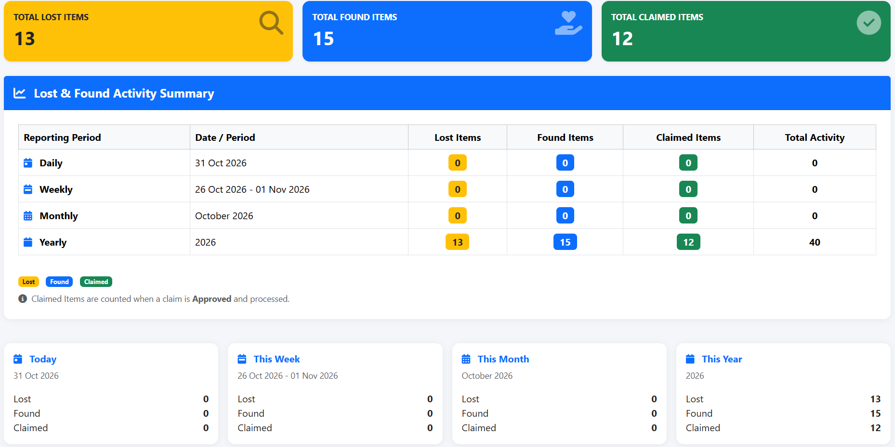
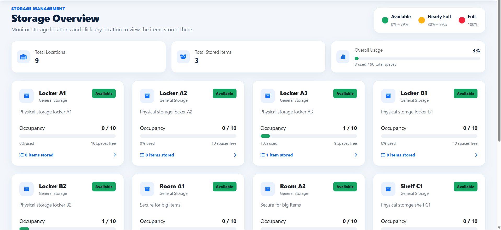
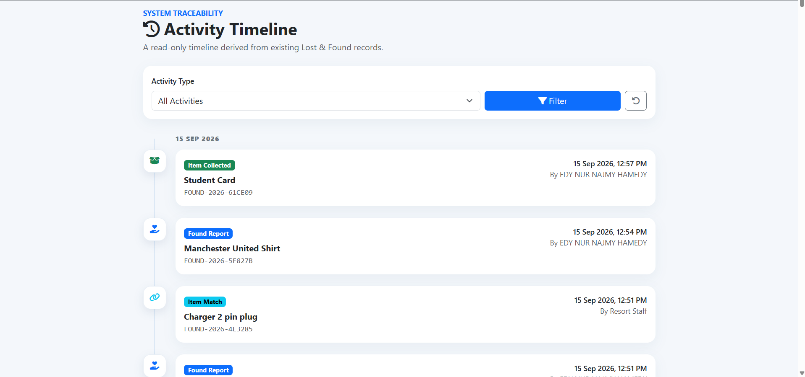

# 🏨 Resort Lost & Found Management System

### A Centralised Lost and Found Management Platform for Resort Operations

<p align="center">
  <strong>Streamlining lost item reporting, found item registration, claim verification and inventory management through an integrated web-based system.</strong>
</p>

### Screenshot

<p align="center">
  
</p>

<p align="center">
  
</p>

<p align="center">
  
</p>

<p align="center">
  
</p>

<p align="center">
  
</p>

<p align="center">
  
</p>

<p align="center">
  
</p>

<p align="center">
  
</p>

<p align="center">
  
</p>

<p align="center">
  
  
  
  
  
</p>

<p align="center">
  
  
  
  
  
</p>

---

## 📌 Table of Contents

- [Project Overview](#-project-overview)
- [Problem Statement](#-problem-statement)
- [Project Objectives](#-project-objectives)
- [Key Features](#-key-features)
- [System Modules](#-system-modules)
- [User Roles and Permissions](#-user-roles-and-permissions)
- [Technologies and Tools](#-technologies-and-tools)
- [System Architecture](#-system-architecture)
- [System Workflow](#-system-workflow)
- [Database Design](#-database-design)
- [System Requirements](#-system-requirements)
- [Installation Guide](#-installation-guide)
- [How to Run the Project](#-how-to-run-the-project)
- [Project Structure](#-project-structure)
- [Security Implementation](#-security-implementation)
- [Email Notification Configuration](#-email-notification-configuration)
- [Testing](#-testing)
- [Challenges and Solutions](#-challenges-and-solutions)
- [My Contributions](#-my-contributions)
- [Future Improvements](#-future-improvements)
- [Acknowledgements](#-acknowledgements)

---

## 🌟 Project Overview

The **Resort Lost & Found Management System** is a web-based application developed to manage lost and found items within a resort environment.

The system provides a centralised platform for guests to report lost belongings, report found items, submit ownership claims and monitor the progress of their reports.

At the operational level, authorised resort personnel can register found items, manage storage locations, verify ownership claims, update item statuses and monitor lost and found activities.

The system also provides administrative functionality for monitoring operational records, managing inventory information and generating reports.

By integrating guest reporting and internal resort operations into one platform, the system aims to improve the organisation, traceability and efficiency of lost and found management.

### Main Purpose

The primary purpose of this system is to:

- Centralise lost and found item records.
- Simplify the process of reporting lost belongings.
- Provide a structured workflow for registering found items.
- Facilitate ownership verification and claim processing.
- Organise the physical storage of found items.
- Monitor item retention and expiry dates.
- Improve communication between guests and resort personnel.
- Provide operational statistics and administrative reports.

### Target Users

The system is designed for:

- Resort guests who have lost personal belongings.
- Guests who want to report found items.
- Resort personnel responsible for recording and managing found items.
- Management personnel responsible for overseeing lost and found operations.

---

## ❗ Problem Statement

Lost and found management is an important operational responsibility within a resort environment.

Guests may accidentally leave personal belongings in public areas, accommodation facilities, restaurants, event spaces or other resort locations.

Without a structured management platform, handling these items may involve several manual processes, making it difficult to maintain accurate records and track their progress.

Some common challenges include:

1. **Unorganised lost item reporting**

   Guests may experience difficulties reporting lost belongings and providing the necessary item information.

2. **Difficult found item tracking**

   Found items require proper registration, identification and record management to prevent information from becoming scattered.

3. **Complex ownership verification**

   Resort personnel need to verify that a claimant is the rightful owner before releasing an item.

4. **Storage management difficulties**

   Physical storage locations need to be monitored to ensure that found items are organised and traceable.

5. **Limited status visibility**

   Guests may have difficulty knowing whether their reported belongings have been found or whether their claims have been processed.

6. **Manual administrative workload**

   Monitoring records, updating statuses and preparing operational reports can become time-consuming without a centralised system.

7. **Item retention management**

   Found items require appropriate retention periods and expiry monitoring according to their assigned categories.

The Resort Lost & Found Management System addresses these challenges through a centralised web application that supports reporting, item registration, claim verification, storage management and administrative monitoring.

---

## 🎯 Project Objectives

The objectives of this project are:

1. To develop a centralised web-based lost and found management platform for resort operations.
2. To provide guests with an accessible interface for reporting lost and found belongings.
3. To implement a structured workflow for recording and managing found items.
4. To facilitate item matching and ownership verification.
5. To provide a claim submission and approval process.
6. To organise found item storage locations and monitor storage capacity.
7. To implement role-based access control for different system users.
8. To provide notification and email communication for relevant reporting and claim activities.
9. To generate operational reports to support management monitoring and decision-making.

---

## ✨ Key Features

The system consists of several interconnected modules designed to support guest reporting and internal resort operations.

### 1. Public Website Module

Provides visitors with access to information about the resort's lost and found procedures.

Features:

- Public landing page.
- Introduction to the Lost & Found Management System.
- Explanation of reporting procedures.
- User guidelines.
- Lost, found and claimed item statistics.
- Quick navigation to reporting functions.
- User registration and login access.

### 2. User Registration and Authentication Module

Allows guests to create accounts and access the system.

Features:

- New user registration.
- Full name registration.
- Email address registration.
- Phone number registration.
- Password-based authentication.
- Secure login and logout.
- Session management.
- Role-based dashboard redirection.
- Forgot password functionality.
- Password reset workflow.
- Account security interface.

### 3. Lost Item Reporting Module

Allows registered guests to report belongings that have been lost within the resort.

Features:

- Submit lost item reports.
- Enter item title and description.
- Select item category.
- Specify the location where the item was lost.
- Enter the date of loss.
- Generate a unique lost report reference code.
- View submitted reports.
- Monitor lost report statuses.
- Track potential matches with found items.

Supported lost report statuses:

| Status | Description |
|---|---|
| Searching | The reported item is being searched for. |
| Matched | A potential found item has been matched to the lost report. |
| Resolved | The lost item case has been resolved. |
| Closed | The report has been closed. |

### 4. Found Item Reporting Module

Allows registered users to report items discovered within the resort.

Features:

- Submit found item information.
- Enter item title.
- Select item category.
- Specify the location where the item was found.
- Enter the date the item was found.
- Provide additional remarks.
- Upload an item photograph.
- Generate a unique found item code.
- Submit the found item report.
- Send confirmation email to the reporting user.

After submitting a found item report, the item can proceed through the resort's internal check-in and storage process.

### 5. Found Item Check-In Module

Allows authorised Recorders and Administrators to register found items into the internal management system.

Features:

- Register found items.
- Review found item information.
- Assign item categories.
- Record the location where an item was discovered.
- Assign a storage location.
- Record the responsible Recorder.
- Upload item photographs.
- Generate and manage item codes.
- Calculate item expiry dates based on category retention periods.
- Update found item statuses.

Found item statuses include:

| Status | Description |
|---|---|
| Pending Check-in | Item has been reported but has not completed the internal check-in process. |
| Stored | Item has been registered and placed into storage. |
| Claim Pending | A claim has been submitted and is awaiting verification. |
| Claimed | The item has been successfully collected. |
| Expired | The item's retention period has expired. |
| Disposed | The item has been disposed of. |

### 6. Item Matching Module

Supports the process of associating lost item reports with corresponding found item records.

Features:

- Retrieve lost item information.
- Retrieve found item information.
- Compare item descriptions and categories.
- Review possible matches.
- Associate found items with lost reports.
- Record match information.
- Update relevant lost report statuses.
- Identify the Reporter associated with a matched item.

The matching functionality supports the claim workflow by connecting a found item with its corresponding lost report.

### 7. Claim Submission Module

Allows eligible Reporters to submit claims for found belongings matched to their lost reports.

Features:

- View matched found items.
- Submit ownership claims.
- Provide proof of ownership information.
- Add proof notes.
- Upload supporting proof photographs.
- Track claim statuses.
- View claim processing information.

Supported claim statuses include:

| Status | Description |
|---|---|
| Pending Verification | Claim is awaiting staff verification. |
| Approved | Ownership claim has been approved. |
| Rejected | Ownership claim has been rejected. |

### 8. Claim Verification and Check-Out Module

Provides Recorders and Administrators with functionality for reviewing ownership claims.

Features:

- View submitted claims.
- Review claimant information.
- Review found item details.
- Examine ownership proof notes.
- Review uploaded proof photographs.
- Approve claims.
- Reject claims.
- Record staff notes.
- Record verification information.
- Update claim processing dates.
- Process item collection.
- Record pickup information.
- Update found item statuses.
- Send claim status email notifications.

The module provides a structured process to help ensure that found items are released only after the appropriate verification process.

### 9. Storage Management Module

Allows authorised personnel to monitor physical storage locations and stored found items.

Features:

- Manage storage location information.
- Display storage location names.
- Display building zones.
- Display storage descriptions.
- Configure storage capacity.
- Monitor occupied storage spaces.
- Calculate storage utilisation.
- Identify available storage capacity.
- Monitor storage location statuses.
- View stored items by location.
- Track items currently stored within the resort.

Storage location statuses include:

| Status | Description |
|---|---|
| Available | Storage location has available capacity. |
| Full | Storage location has reached its capacity. |
| Maintenance | Storage location is under maintenance. |

### 10. Notification Module

Provides in-system notifications for relevant user activities.

Features:

- Create notification records.
- Display user notifications.
- View unread notification counts.
- Mark notifications as read.
- Track notification creation dates.
- Notify relevant users about found item and claim-related activities.

Notifications are intended for the relevant Reporter and Recorder workflows.

### 11. Email Notification Module

The system integrates PHPMailer to support email communication through SMTP.

Features:

- Lost item report confirmation emails.
- Found item report confirmation emails.
- Claim status email notifications.
- Email formatting using HTML templates.
- SMTP authentication.
- Email delivery error logging.
- Email testing functionality.

Email communication helps keep relevant users informed about important reporting and claim activities.

### 12. Admin Dashboard Module

Provides Administrators with an overview of lost and found operations.

Features:

- Overall system statistics.
- Total lost item records.
- Total found item records.
- Total claimed item records.
- Stored item information.
- Expired item information.
- Storage-related statistics.
- Operational summaries.
- Administrative management overview.

### 13. Recorder Dashboard Module

Provides Recorders with an operational interface for managing found items and ownership claims.

Features:

- Found item management.
- Item check-in operations.
- Item matching management.
- Claim verification.
- Claim approval and rejection.
- Item collection processing.
- Storage monitoring.
- Operational status tracking.
- Notifications.

### 14. Reporter Dashboard Module

Provides registered guests with an overview of their lost and found activities.

Features:

- Personal dashboard.
- Lost item report history.
- Found item report history.
- Found item information.
- Matched item information.
- Claim submission access.
- Claim status tracking.
- Notification access.
- Report and item status monitoring.

### 15. Admin Reporting Module

Provides management with operational reporting functionality.

Features:

- Lost item reports.
- Found item reports.
- Claimed item reports.
- Daily reporting.
- Weekly reporting.
- Monthly reporting.
- Yearly reporting.
- Overall statistics.
- Twelve-month reporting comparison.
- Report data visualisation.
- Print-friendly reports.

---

## 🧩 System Modules Overview

| Module | Main Functionality |
|---|---|
| Public Website | System introduction and reporting information |
| User Authentication | Registration, login and password recovery |
| Lost Item Reporting | Submit and monitor lost item reports |
| Found Item Reporting | Submit found item reports |
| Found Item Check-In | Internal found item registration |
| Item Matching | Associate lost reports with found items |
| Claim Submission | Submit ownership claims |
| Claim Verification | Review and process ownership claims |
| Storage Management | Monitor storage locations and capacity |
| Notifications | In-system notification management |
| Email Notifications | Automated reporting and claim emails |
| Admin Dashboard | Overall operational monitoring |
| Recorder Dashboard | Internal item and claim operations |
| Reporter Dashboard | Personal reporting and claim monitoring |
| Admin Reports | Operational statistics and printable reports |

---

## 👥 User Roles and Permissions

The system implements role-based access control with three primary user roles.

### 1. Administrator

The Administrator is responsible for overall system administration and operational oversight.

Responsibilities:

- Access the administrative dashboard.
- Monitor system statistics.
- Oversee lost and found records.
- Monitor found item storage.
- Review operational information.
- Access administrative reports.
- Manage administrative operations.
- Monitor item retention and expiry information.
- Access authorised claim management functions.

### 2. Recorder

The Recorder is responsible for handling found items and managing internal lost and found operations.

Responsibilities:

- Access the Recorder dashboard.
- Register found items.
- Process found item check-ins.
- Manage item matching.
- Review ownership claims.
- Verify claim information.
- Approve or reject claims.
- Process item collection.
- Manage storage information.
- Monitor stored items.
- Receive relevant notifications.

### 3. Reporter

The Reporter represents a guest or individual using the system to report lost or found belongings.

Responsibilities:

- Register an account.
- Log in to the system.
- Submit lost item reports.
- Submit found item reports.
- View personal report history.
- Monitor report statuses.
- View matched found items.
- Submit ownership claims.
- Upload proof of ownership.
- Track claim processing.
- Receive relevant notifications.

### Role Summary

| Feature | Admin | Recorder | Reporter |
|---|:---:|:---:|:---:|
| View personal dashboard | ✓ | ✓ | ✓ |
| Submit lost reports | - | - | ✓ |
| Submit found reports | - | - | ✓ |
| Register found item check-in | ✓ | ✓ | - |
| Manage item matching | ✓ | ✓ | - |
| Submit ownership claims | - | - | ✓ |
| Verify ownership claims | ✓ | ✓ | - |
| Approve or reject claims | ✓ | ✓ | - |
| Process item collection | ✓ | ✓ | - |
| Monitor storage | ✓ | ✓ | - |
| View operational reports | ✓ | - | - |
| Access notifications | ✓ | ✓ | ✓ |

**Note:** Access is enforced through the PHP role-checking implementation. The table represents the intended responsibilities of each role.

---

## 🛠️ Technologies and Tools

The project uses a PHP-based web development stack integrated with a relational database and email delivery library.

### Programming Languages

| Technology | Purpose |
|---|---|
| PHP | Backend application logic |
| JavaScript | Client-side interactions |
| HTML5 | Web page structure |
| CSS3 | User interface styling |
| SQL | Database operations |

### Frontend Technologies

| Technology | Purpose |
|---|---|
| HTML5 | Application structure |
| CSS3 | Interface styling |
| Bootstrap 5.3.2 | Responsive layout and UI components |
| JavaScript | Interactive components |
| Font Awesome 6.4.2 | Interface icons |
| Chart.js | Dashboard statistics and data visualisation |

### Backend Technologies

| Technology | Purpose |
|---|---|
| PHP | Server-side processing |
| PDO | Database connectivity |
| PHP Sessions | Authentication and session management |
| PHPMailer 7.1.1 | Email delivery through SMTP |
| Composer | PHP dependency management |

### Database Management

| Technology | Purpose |
|---|---|
| MariaDB / MySQL | Relational database management |
| InnoDB | Database storage engine |
| utf8mb4 | Character encoding |

### Development Tools

| Tool | Purpose |
|---|---|
| Visual Studio Code | Source code development |
| XAMPP | Local Apache and MySQL environment |
| phpMyAdmin | Database administration |
| Git | Version control |
| GitHub | Source code hosting |
| Composer | Dependency installation |

### External Services

| Service | Purpose |
|---|---|
| Gmail SMTP | Email delivery |
| CDN | Bootstrap and Font Awesome resources |
| Chart.js CDN | Dashboard charts |

---

## 🏗️ System Architecture

The application follows a server-rendered PHP architecture with a relational database.

Users access the system through a web browser. PHP processes requests, checks user permissions, validates submitted information and communicates with the database through PDO.

The application uses different interfaces according to the authenticated user's role.

### Architecture Diagram

```text
                  SYSTEM USERS
                       |
          +------------+------------+
          |            |            |
          v            v            v
        ADMIN       RECORDER      REPORTER
          |            |            |
          +------------+------------+
                       |
                       v
                  WEB BROWSER
                       |
                       v
               PRESENTATION LAYER
                  HTML / CSS
                  BOOTSTRAP
                  JAVASCRIPT
                       |
                       v
                APPLICATION LAYER
                      PHP
                       |
         +-------------+-------------+
         |             |             |
         v             v             v
    AUTHENTICATION  BUSINESS LOGIC  ROLE ACCESS
         |             |             |
         +-------------+-------------+
                       |
              +--------+--------+
              |                 |
              v                 v
        DATABASE LAYER      EMAIL SERVICE
             PDO              SMTP
              |                 |
              v                 v
          MARIADB            PHPMailer
              |
              v
         RESORT LOST & FOUND
            DATABASE
```

### Main Application Components

| Component | Responsibility |
|---|---|
| Public Interface | Provides system information and reporting access |
| Reporter Interface | Handles personal lost and found activities |
| Recorder Interface | Manages found items, storage and claims |
| Admin Interface | Provides administrative monitoring and reporting |
| Authentication Layer | Handles login and session management |
| Authorization Layer | Controls access based on user roles |
| Business Logic | Processes reporting, matching and claims |
| Database Layer | Stores application records |
| Email Service | Sends reporting and claim notifications |

---

## 🔄 System Workflow

### 1. Lost Item Reporting Workflow

```text
             START
               |
               v
         Guest Registers
               |
               v
           User Login
               |
               v
       Open Reporter Dashboard
               |
               v
       Select Report Lost Item
               |
               v
       Enter Item Information
               |
               v
       Select Category and Location
               |
               v
         Submit Lost Report
               |
               v
       Save Report in Database
               |
               v
       Generate Reference Code
               |
               v
       Update Reporter Dashboard
               |
               v
              END
```

### 2. Found Item Registration Workflow

```text
          Found Item Discovered
                   |
                   v
          Item Report Submitted
                   |
                   v
          Recorder Receives Record
                   |
                   v
          Review Found Item Details
                   |
                   v
          Register Item Check-In
                   |
                   v
          Assign Category and Storage
                   |
                   v
          Calculate Expiry Date
                   |
                   v
          Update Item Status
                   |
                   v
             Item Stored
                   |
                   v
                  END
```

### 3. Item Matching and Claim Workflow

```text
          Lost Item Report
                 |
                 v
          Found Item Record
                 |
                 v
          Compare Item Details
                 |
                 v
          Identify Potential Match
                 |
                 v
          Associate Lost and Found
                 |
                 v
          Reporter Views Match
                 |
                 v
          Submit Ownership Claim
                 |
                 v
          Upload Supporting Proof
                 |
                 v
          Recorder Reviews Claim
                 |
                 v
          Ownership Verification
                 |
           +-----+------+
           |            |
           v            v
         Approve      Reject
           |            |
           v            v
       Process       Update Claim
       Collection      Status
           |
           v
       Update Item Status
           |
           v
       Send Email Notification
           |
           v
          END
```

### 4. Storage Management Workflow

```text
          Found Item Check-In
                  |
                  v
          Select Storage Location
                  |
                  v
          Check Storage Capacity
                  |
                  v
          Assign Storage Location
                  |
                  v
          Update Occupied Capacity
                  |
                  v
          Monitor Stored Items
                  |
                  v
          Monitor Expiry Dates
                  |
                  v
          Update Item Status
                  |
                  v
                 END
```

---

## 🗄️ Database Design

### Database Information

| Item | Details |
|---|---|
| Database Name | `resort_lost_found` |
| Database System | MariaDB / MySQL |
| Database Server Version in SQL Dump | MariaDB 10.4.32 |
| Character Encoding | utf8mb4 |
| Collation | utf8mb4_unicode_ci |
| Storage Engine | InnoDB |
| Connection Method | PHP PDO |
| Database Configuration | `db.php` |
| Main SQL File | `resort_lost_found_fixed.sql` |

### Main Database Tables

The supplied SQL file defines seven main tables.

| Table | Purpose |
|---|---|
| `users` | Stores user accounts, contact information, passwords and roles. |
| `categories` | Stores item categories and their retention periods. |
| `lost_items` | Stores lost item reports submitted by Reporters. |
| `found_items` | Stores found item information and processing statuses. |
| `claims` | Stores ownership claims and verification information. |
| `storage_locations` | Stores physical storage location information and capacity. |
| `notifications` | Stores notification records related to found items. |

### Table Descriptions

#### 1. users

Stores system user information.

Important fields:

- `user_id`
- `full_name`
- `email`
- `phone_number`
- `password`
- `role`
- `created_at`
- `updated_at`

#### 2. categories

Stores item categories and retention periods.

Important fields:

- `category_id`
- `category_name`
- `retention_months`

The supplied SQL includes these initial categories:

| Category | Retention Period |
|---|---|
| Small Size Item | 6 months |
| Medium Size Item | 6 months |
| Big Size Item | 6 months |
| Valuable Item | 8 months |

#### 3. lost_items

Stores guest lost item reports.

Important fields:

- `report_id`
- `reference_code`
- `reporter_id`
- `item_title`
- `category_id`
- `location_lost`
- `date_lost`
- `description`
- `status`
- `created_at`

#### 4. found_items

Stores found item information.

Important fields:

- `item_id`
- `item_code`
- `title`
- `category_id`
- `location_found`
- `storage_location_id`
- `image_path`
- `reporter_id`
- `recorder_handler_id`
- `status`
- `date_found`
- `expiry_date`
- `remarks`

#### 5. claims

Stores ownership claims submitted by Reporters.

Important fields:

- `claim_id`
- `found_item_id`
- `lost_report_id`
- `claimant_id`
- `handled_by_recorder_id`
- `proof_notes`
- `proof_image_path`
- `status`
- `staff_notes`
- `date_claimed`
- `date_processed`
- `verification_notes`
- `checkout_date`

#### 6. storage_locations

Stores resort storage information.

Important fields:

- `location_id`
- `location_name`
- `description`
- `building_zone`
- `capacity`
- `status`

#### 7. notifications

Stores notification information.

Important fields:

- `notification_id`
- `found_item_id`
- `message`
- `is_read`
- `created_at`

### Database Relationships

The database uses primary keys and foreign keys to maintain relationships between records.

Important relationships include:

- A user can submit multiple lost item reports.
- A user can submit multiple found item reports.
- Each lost item report belongs to a category.
- Each found item belongs to a category.
- A found item can be assigned to a storage location.
- A found item can have multiple associated claim records.
- A claim belongs to a claimant.
- A claim can reference a lost item report.
- A claim can be handled by a Recorder.
- A found item can generate multiple notification records.

### Additional Application Table

The PHP application also references:

`item_matches`

This table is used to associate lost reports with found item records and maintain matching statuses.

**Important database limitation:** The supplied `resort_lost_found_fixed.sql` file does not contain the `item_matches` table definition, even though multiple application pages depend on it.

The SQL file also defines `notifications` without a `user_id` column, while the PHP notification functionality queries notifications by `user_id`.

These database differences must be reconciled before a fresh installation can fully support all current application workflows.

Do not assume the supplied SQL file alone is a complete production-ready database export.

---

## 💻 System Requirements

### Software Requirements

| Software | Requirement |
|---|---|
| Operating System | Windows, macOS or Linux |
| PHP | PHP 8.2 recommended |
| Web Server | Apache |
| Database | MariaDB 10.4+ or compatible MySQL |
| Browser | Chrome, Firefox, Edge or Safari |
| Local Environment | XAMPP |
| Database Administration | phpMyAdmin |
| Dependency Manager | Composer |

### Required PHP Extensions

Ensure the following PHP extensions are enabled:

- PDO
- PDO MySQL
- OpenSSL
- Fileinfo
- Filter
- Ctype
- Hash

OpenSSL is particularly important for secure SMTP email communication.

### Hardware Requirements

A standard computer capable of running Apache, PHP and a MariaDB/MySQL database server is sufficient for local development.

---

## ⚙️ Installation Guide

Follow the steps below to configure the application in a local development environment.

### Step 1: Clone the Repository

Open your terminal:

```bash
git clone https://github.com/YOUR_USERNAME/YOUR_REPOSITORY.git
```

Navigate into the project folder:

```bash
cd YOUR_REPOSITORY
```

### Step 2: Install XAMPP

Download and install XAMPP.

Start the following services:

- Apache
- MySQL

### Step 3: Move the Project into htdocs

Place the extracted project folder inside the XAMPP web directory.

Example:

```text
C:\xampp\htdocs\finalproject\
```

The project structure should contain:

```text
C:\xampp\htdocs\finalproject\
├── admin_dashboard.php
├── recorder_dashboard.php
├── reporter_dashboard.php
├── db.php
├── login.php
├── register.php
├── resort_lost_found_fixed.sql
└── ...
```

### Step 4: Create the Database

Open phpMyAdmin:

```text
http://localhost/phpmyadmin
```

Create a database named:

```sql
resort_lost_found
```

Recommended database settings:

```sql
CHARACTER SET utf8mb4
COLLATE utf8mb4_unicode_ci
```

### Step 5: Import the Database

Select the `resort_lost_found` database.

Open the Import tab and import:

```text
resort_lost_found_fixed.sql
```

This SQL file creates the seven main database tables and inserts initial category records and a sample user record.

**Important:** Before using the application, address the missing `item_matches` table and the missing `notifications.user_id` column described in the Database Design section.

Do not import the SQL file into an existing production database without first creating a backup.

Also review and remove any personal or demonstration account data before publishing the SQL file publicly.

### Step 6: Configure Database Connection

Open:

```text
db.php
```

The local database configuration uses:

```php
$host     = '127.0.0.1';
$db       = 'resort_lost_found';
$user     = 'root';
$pass     = '';
$charset  = 'utf8mb4';
```

Update the values according to your local MySQL configuration.

For example:

```php
$host     = '127.0.0.1';
$db       = 'resort_lost_found';
$user     = 'root';
$pass     = 'your_database_password';
$charset  = 'utf8mb4';
```

### Step 7: Install Composer Dependencies

The project uses PHPMailer for SMTP email functionality.

The required dependency is declared in:

```text
composer.json
```

Install the dependencies using:

```bash
composer install
```

This creates or updates the Composer autoload files and vendor dependencies.

The project uses:

```text
phpmailer/phpmailer
```

Version locked in the supplied Composer lock file:

```text
7.1.1
```

### Step 8: Configure SMTP Email

Open:

```text
email_config.php
```

Configure the SMTP settings using your own email service credentials.

Example configuration:

```php
return [
    'host'       => 'smtp.gmail.com',
    'port'       => 587,
    'username'   => 'YOUR_EMAIL@gmail.com',
    'password'   => 'YOUR_GOOGLE_APP_PASSWORD',
    'encryption' => 'tls',
    'from_email' => 'YOUR_EMAIL@gmail.com',
    'from_name'  => 'Resort Lost & Found Management System',
];
```

For Gmail:

1. Enable two-step verification.
2. Generate a Google App Password.
3. Use the App Password in the SMTP configuration.
4. Do not use your normal Gmail password.

**Security warning:** Never commit real SMTP credentials to GitHub. The supplied archive contains hardcoded SMTP credentials in `email_config.php`. Revoke or rotate those credentials before publishing the repository and replace them with protected configuration.

### Step 9: Check Upload Directory Permissions

Ensure that the web server can write to:

```text
uploads/
uploads/proofs/
```

These directories are used to store:

- Found item photographs.
- Supporting ownership proof images.

---

## 🚀 How to Run the Project

After completing the installation:

1. Open XAMPP Control Panel.
2. Start Apache.
3. Start MySQL.
4. Confirm that the database exists.
5. Confirm that the database structure is compatible with the application.
6. Confirm that Composer dependencies are installed.
7. Configure SMTP if email functionality is required.
8. Open your browser.

Access the application:

```text
http://localhost/finalproject/
```

### Main Application Pages

| Module | URL |
|---|---|
| Public Homepage | `http://localhost/finalproject/index.php` |
| Login | `http://localhost/finalproject/login.php` |
| Registration | `http://localhost/finalproject/register.php` |
| Forgot Password | `http://localhost/finalproject/forgot_password.php` |
| Reporter Dashboard | `http://localhost/finalproject/reporter_dashboard.php` |
| Recorder Dashboard | `http://localhost/finalproject/recorder_dashboard.php` |
| Admin Dashboard | `http://localhost/finalproject/admin_dashboard.php` |
| Report Lost Item | `http://localhost/finalproject/report_lost.php` |
| Report Found Item | `http://localhost/finalproject/report_found.php` |
| Log Found Item | `http://localhost/finalproject/log_found.php` |
| Submit Claim | `http://localhost/finalproject/submit_claim.php` |
| Verify Claims | `http://localhost/finalproject/verify_claim.php` |
| Storage Overview | `http://localhost/finalproject/storage_overview.php` |
| Notifications | `http://localhost/finalproject/notifications.php` |
| Admin Reports | `http://localhost/finalproject/admin_reports.php` |

Users are redirected to the appropriate dashboard based on their assigned roles after successful authentication.

---

## 📁 Project Structure

The following directory structure represents the supplied project.

```text
finalproject/
│
├── admin_dashboard.php
├── admin_reports.php
├── admin_report_print.php
│
├── recorder_dashboard.php
├── reporter_dashboard.php
│
├── index.php
│
├── login.php
├── login_process.php
├── login_forgot_password.php
├── login_required.php
├── logout.php
│
├── register.php
├── register_process.php
│
├── forgot_password.php
├── reset_password.php
├── account_security.php
│
├── report_lost.php
├── report_found.php
├── process_lost_report.php
├── process_found_report.php
│
├── log_found.php
├── submit_claim.php
├── verify_claim.php
│
├── storage_overview.php
├── activity_timeline.php
│
├── notifications.php
├── notification_helper.php
│
├── auth_check.php
├── auto_check.php
├── login_required.php
│
├── db.php
│
├── email_config.php
├── email_helper.php
├── email_test.php
│
├── composer.json
├── composer.lock
│
├── resort_lost_found_fixed.sql
│
├── uploads/
│   ├── FOUND-*.png
│   ├── FOUND-*.jpg
│   └── proofs/
│
└── vendor/
    ├── autoload.php
    ├── composer/
    └── phpmailer/
```

### Important Files and Directories

| File / Directory | Description |
|---|---|
| `index.php` | Public landing page and system information |
| `login.php` | User authentication interface |
| `register.php` | User registration interface |
| `login_process.php` | Processes login requests |
| `register_process.php` | Processes registration requests |
| `db.php` | PDO database connection |
| `auth_check.php` | Role-based access control |
| `admin_dashboard.php` | Administrative dashboard |
| `recorder_dashboard.php` | Recorder operational dashboard |
| `reporter_dashboard.php` | Reporter dashboard |
| `report_lost.php` | Lost item reporting form |
| `report_found.php` | Found item reporting form |
| `process_lost_report.php` | Processes lost item submissions |
| `process_found_report.php` | Processes found item submissions |
| `log_found.php` | Registers found items internally |
| `submit_claim.php` | Handles ownership claim submissions |
| `verify_claim.php` | Handles claim verification and collection |
| `storage_overview.php` | Storage location monitoring |
| `notifications.php` | Notification management |
| `admin_reports.php` | Administrative reporting |
| `admin_report_print.php` | Print-friendly operational reports |
| `email_config.php` | SMTP configuration |
| `email_helper.php` | Email delivery functions |
| `notification_helper.php` | Notification creation functions |
| `resort_lost_found_fixed.sql` | Main database SQL export |
| `uploads/` | Stores uploaded item photographs and claim proof images |
| `vendor/` | Composer dependencies, including PHPMailer |

---

## 🔐 Security Implementation

The application includes several security mechanisms.

| Security Feature | Implementation |
|---|---|
| Authentication | PHP session-based authentication |
| Password Security | PHP password hashing and verification |
| Role-Based Access | Role validation through `auth_check.php` |
| SQL Injection Protection | PDO prepared statements |
| Output Protection | HTML escaping |
| Session Security | Session management and ID regeneration |
| Password Recovery | Password reset workflow |
| Email Security | SMTP authentication and TLS |
| Upload Handling | Image upload validation |
| Error Handling | Server-side error logging |
| Claim Verification | Staff verification workflow |

### Security Recommendations

Before production deployment, the following improvements are recommended:

- Move SMTP credentials into environment variables.
- Remove personal and demonstration account data from public SQL exports.
- Enforce HTTPS.
- Review file upload restrictions.
- Disable public access to configuration files.
- Apply appropriate password and session policies.
- Review role-based permissions.
- Implement CSRF protection consistently across all state-changing forms.
- Add automated database backups.
- Review database foreign key consistency.
- Ensure uploaded files cannot execute as PHP scripts.

---

## 📧 Email Notification Configuration

The application uses PHPMailer to send emails through SMTP.

### Email Library

```text
phpmailer/phpmailer
```

Version:

```text
7.1.1
```

### Supported Email Workflows

| Workflow | Email Functionality |
|---|---|
| Lost Item Reporting | Sends submission confirmation to the Reporter |
| Found Item Reporting | Sends submission confirmation to the Reporter |
| Claim Verification | Sends claim status updates to the claimant |
| Claim Rejection | Sends rejection notification |
| Item Collection | Sends collection-related notification |

### Email Configuration Files

| File | Purpose |
|---|---|
| `email_config.php` | SMTP account configuration |
| `email_helper.php` | Email generation and delivery |
| `email_test.php` | Email testing interface |
| `composer.json` | PHPMailer dependency declaration |
| `composer.lock` | Locked dependency version |

### Email Setup

1. Install PHPMailer through Composer.
2. Configure your SMTP account.
3. Use a Google App Password if using Gmail.
4. Verify the SMTP configuration.
5. Test email delivery using the available email testing interface.
6. Review PHP error logs if delivery fails.

**Important:** Email delivery failure does not necessarily prevent the corresponding lost or found report from being saved. The application includes error handling to record email delivery failures.

---

## 🧪 Testing

The supplied source code was reviewed for PHP syntax, application structure and database implementation.

### Source Code Validation

| Test | Result |
|---|---|
| PHP source inspection | Completed |
| PHP syntax validation | Passed for 34 PHP files |
| Database schema inspection | Completed |
| Role implementation inspection | Completed |
| Email integration inspection | Completed |
| File upload handler inspection | Completed |
| Full runtime testing | Not independently verified |
| Full end-to-end testing | Not independently verified |

### Recommended Functional Test Cases

The following test scenarios should be executed in a running local environment.

| Test ID | Test Scenario | Expected Result |
|---|---|---|
| TC01 | Register a new Reporter account | Account is created |
| TC02 | Login using valid credentials | User is authenticated |
| TC03 | Login using invalid credentials | Access is denied |
| TC04 | Access a restricted page without permission | Access is denied |
| TC05 | Submit a lost item report | Lost report is saved |
| TC06 | Submit a found item report | Found report is saved |
| TC07 | Register a found item check-in | Item record is updated |
| TC08 | Assign a storage location | Item is associated with storage |
| TC09 | Match a lost report with a found item | Match information is recorded |
| TC10 | Submit an ownership claim | Claim is created |
| TC11 | Upload ownership proof | Proof image is stored |
| TC12 | Approve a claim | Claim status is updated |
| TC13 | Reject a claim | Claim status is updated |
| TC14 | Process item collection | Collection status is recorded |
| TC15 | View storage overview | Storage capacity information is displayed |
| TC16 | Mark notification as read | Notification status is updated |
| TC17 | Send reporting confirmation email | Email delivery is attempted |
| TC18 | Generate administrative report | Report data is displayed |
| TC19 | Print an operational report | Print-friendly report is generated |
| TC20 | Reset user password | Password reset workflow is processed |

**Note:** These are recommended functional test scenarios, not claims of completed runtime testing.

---

## 🧩 Challenges and Solutions

The following technical areas represent important implementation considerations within the system.

| Technical Challenge | Implementation Approach |
|---|---|
| Managing multiple user roles | Role-based access control using PHP session information |
| Organising lost and found records | Separate lost and found database tables |
| Identifying potential item matches | Dedicated matching workflow linking lost and found records |
| Verifying item ownership | Claim submission with proof notes and supporting images |
| Managing physical storage | Storage location records with capacity monitoring |
| Tracking item retention | Category-based retention periods and expiry dates |
| Monitoring claim progress | Dedicated claim status and verification records |
| Improving user communication | Email notifications using PHPMailer |
| Monitoring operational activities | Separate Admin, Recorder and Reporter dashboards |
| Generating management reports | Date-based report queries and Chart.js visualisation |

---

## 👨‍💻 My Contributions

The project involves the development of a resort-oriented Lost & Found Management System using PHP, MariaDB/MySQL, Bootstrap and JavaScript.

The application includes guest-facing reporting functionality and internal operational modules for managing found items and ownership claims.

Development responsibilities represented in the project include:

- Designing and developing the web application structure.
- Implementing user registration and authentication.
- Developing role-based access control.
- Implementing lost item reporting.
- Implementing found item reporting.
- Developing internal found item registration.
- Implementing item matching functionality.
- Developing ownership claim submission.
- Implementing claim verification and processing.
- Developing storage location monitoring.
- Integrating in-system notifications.
- Integrating email notifications using PHPMailer.
- Developing administrative and operational dashboards.
- Implementing reporting and data visualisation.
- Integrating the application with MariaDB/MySQL.
- Conducting source code validation and preparing technical documentation.

---

## 🔮 Future Improvements

The following features are suggested enhancements for future versions and are not claimed as existing functionality.

### 1. Advanced Item Matching

- Automated matching based on item descriptions.
- Image similarity comparison.
- More advanced category matching.
- Matching confidence indicators.
- Automated notifications when potential matches are identified.

### 2. QR Code Integration

- QR codes for found item identification.
- QR-coded storage locations.
- Faster item check-in and check-out.
- QR-based inventory tracking.

### 3. Enhanced Storage Management

- Visual storage location maps.
- Advanced storage utilisation analytics.
- Automated expiry reminders.
- More detailed item movement history.
- Improved disposal record management.

### 4. Advanced Notifications

- Real-time notification updates.
- Additional email notification templates.
- Automated claim reminders.
- Improved notification delivery monitoring.

### 5. Enhanced Reporting

- PDF report export.
- Excel report export.
- Advanced operational analytics.
- Item recovery performance indicators.
- Category-based reporting.
- Storage utilisation trends.

### 6. Improved Security

- Multi-factor authentication.
- Stronger password policies.
- More comprehensive audit logging.
- Enhanced file upload security.
- Automated database backup scheduling.

### 7. Mobile Accessibility

- Progressive Web App support.
- Mobile-friendly reporting interface.
- Camera-based item reporting.
- Improved mobile staff operations.

---

## 🙏 Acknowledgements

Special appreciation to:

- Berjaya Hills Resort for the project context and operational environment.
- The PHP development community.
- The MariaDB and MySQL development communities.
- The Bootstrap development team.
- The PHPMailer developers.
- The Font Awesome team.
- The Chart.js developers.
- All individuals who provided guidance, feedback and support throughout the development process.

---

<p align="center">
  <strong>Resort Lost & Found Management System</strong>
  <br><br>
  <em>Organising Lost Items. Simplifying Claims. Improving Resort Operations.</em>
</p>
