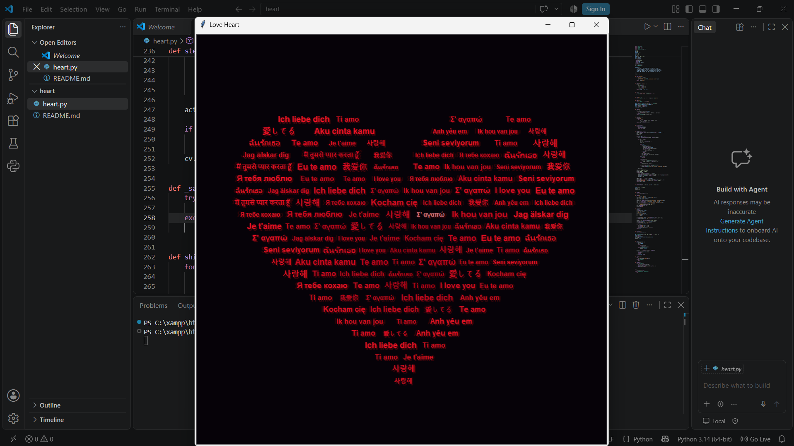

# Multilingual Love Heart ❤️ from https://github.com/iremcnar

A generative typographic art experiment in Python that renders a heart silhouette composed of "I love you" in 20 different languages, featuring smooth floating animations and a subtle shimmering effect.

<p align="center">
  
</p>

## Features
- **Parametric Heart Boundary:** Uses a parametric heart curve to calculate exact scanline boundaries and text placement.
- **Multilingual Typography:** Cycles dynamically through love phrases in 20 languages with proportional font scaling.
- **Smooth Animation:** Eased vertical float-in transitions (`cubic ease-out`) with color grading from deep crimson to glowing edges.
- **Post-Render Shimmer:** Continuous ambient glimmers on random phrases once drawing completes.
- **Zero External Dependencies:** Built entirely with Python's standard library (`turtle`, `tkinter`, `math`, `random`).

## How to Run

```bash
python love.py
