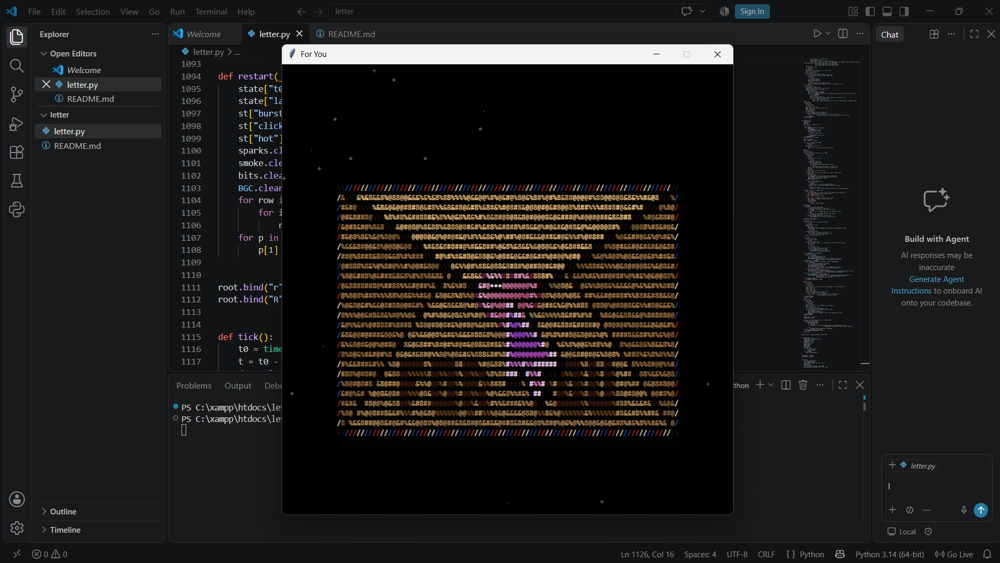

#  Special Letter 💌 from https://github.com/iremcnar

A generative ASCII art animation in Python: a sealed love letter is opened with a click, burns away in a wave of fire, and its embers fly up to form a glowing rose.

<!-- Add a screenshot or GIF of the animation here -->
<p align="center">
  
</p>


## Features
- **Pure ASCII Rendering:** Every frame is drawn as colored monospace characters on a `tkinter` canvas, with 40-level color quantization and per-cell caching to keep it smooth.
- **Cinematic Sequence:** An envelope with a heart-shaped wax seal fades in, a glowing cursor flies in and clicks the seal, and the paper ignites from the seal outward.
- **Fire Simulation:** Burning is driven by a cellular-automaton heat field with a fire color ramp, plus rising sparks, embers and drifting smoke.
- **Ember-to-Rose Transformation:** Embers from the burning paper float along curved paths and settle into place, building a rose (petal spirals, sepals, stem, thorns and leaves) from top to bottom.
- **Radiant Finale:** A soft blue background with animated light rays, twinkling stars and floating motes appears behind the finished rose, with a shimmering rim light on its edges.
- **Procedural Details:** Value noise for burn irregularity, hand-built polygon cursor, shockwave rings and click particles.
- **Zero External Dependencies:** Built entirely with Python's standard library (`tkinter`, `math`, `random`, `time`, `bisect`).

## How to Run

```bash
python letter.py
```
