# 📚 StudyMate — Your Personal Study Companion

### A Web-Based Academic Management and Study Planning System

<p align="center">
  <strong>Plan Smarter. Study Better. Achieve More.</strong>
  <br>
  An integrated academic productivity platform designed to help university students organise assignments, examinations, study schedules and academic activities in one place.
</p>

### Screenshot

<p align="center">
  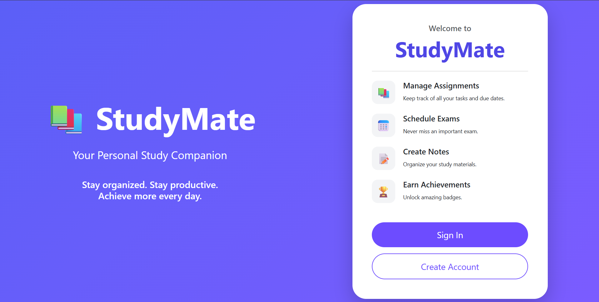
</p>

<p align="center">
  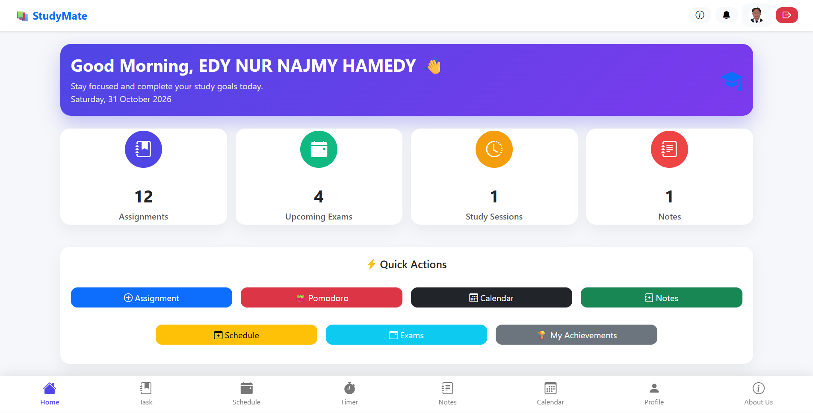
</p>

<p align="center">
  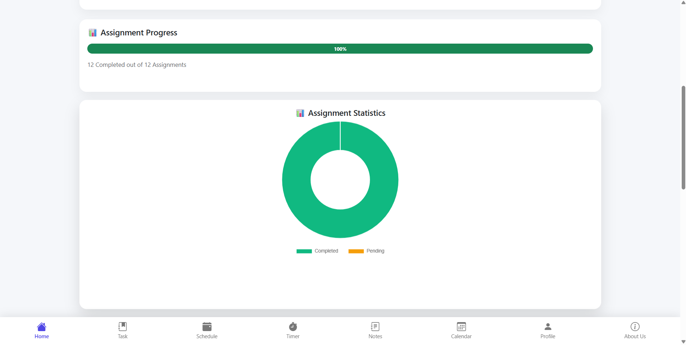
</p>

<p align="center">
  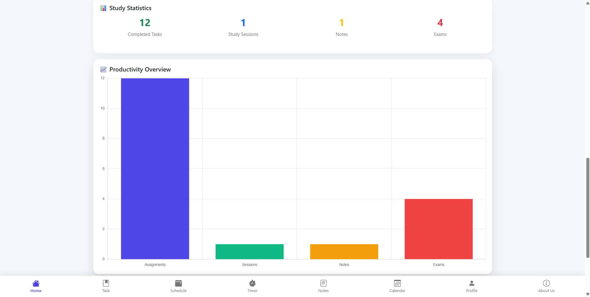
</p>

<p align="center">
  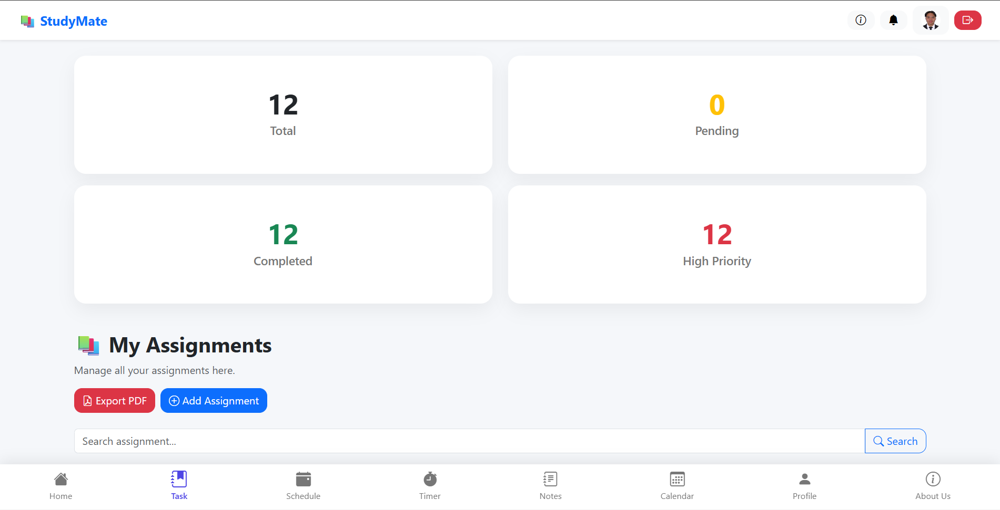
</p>

<p align="center">
  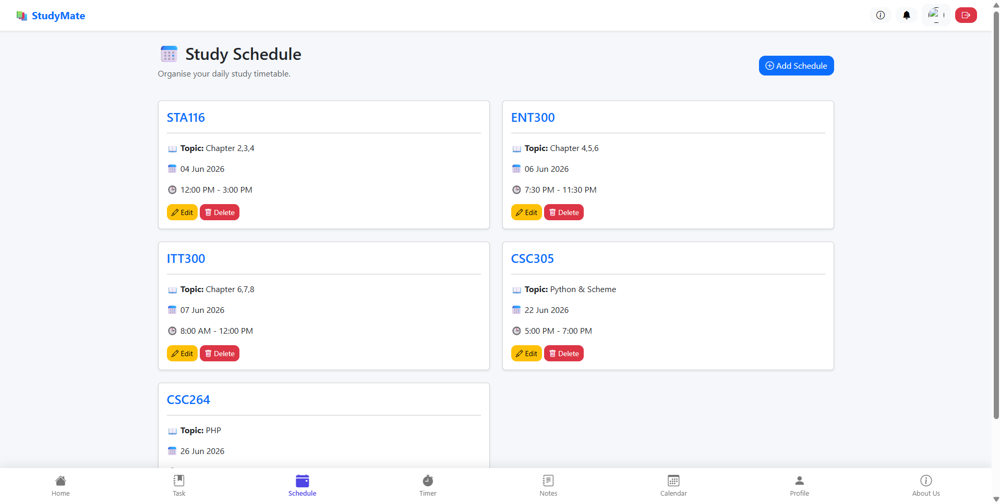
</p>

<p align="center">
  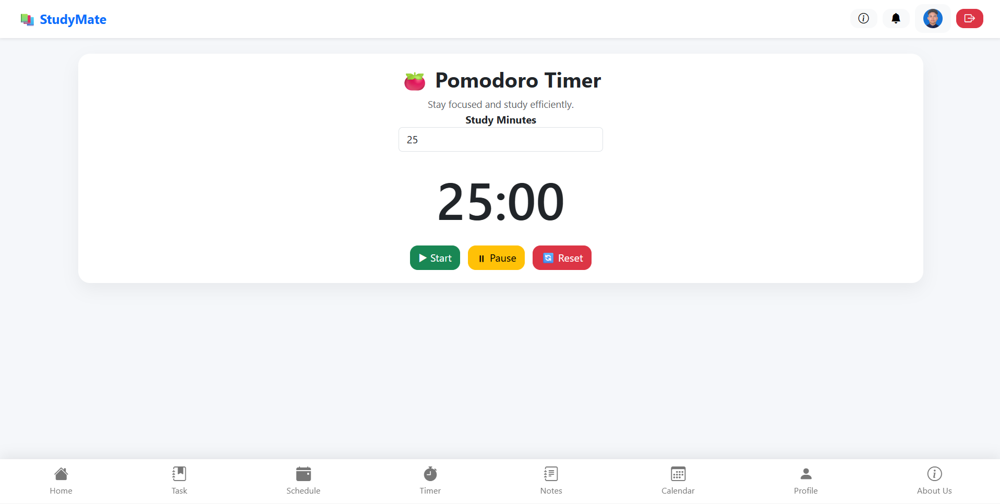
</p>

<p align="center">
  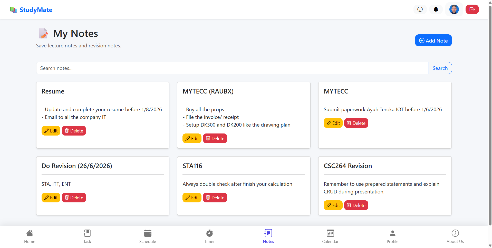
</p>

<p align="center">
  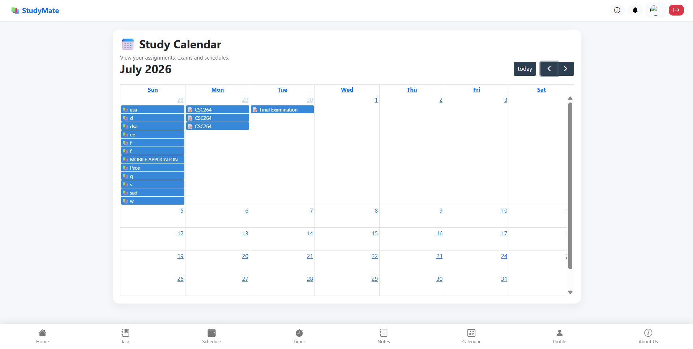
</p>

<p align="center">
  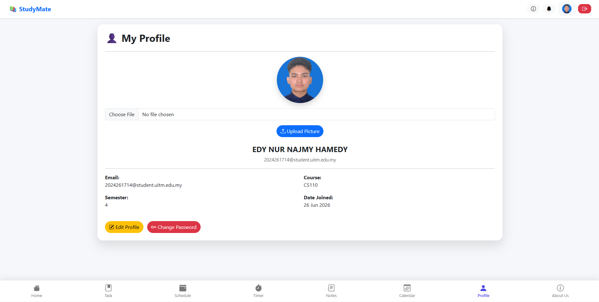
</p>

<p align="center">
  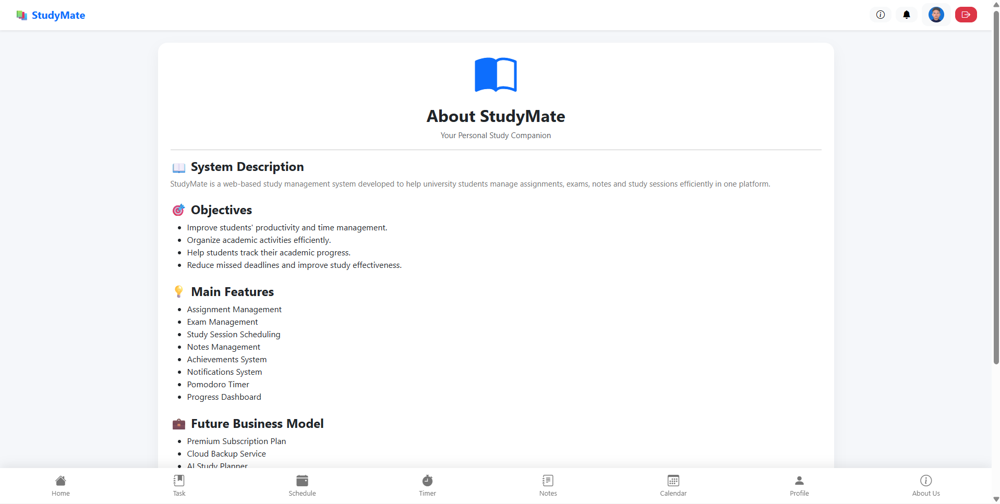
</p>

<p align="center">
  
  
  
  
</p>

<p align="center">
  
  
  
  
</p>

---

## 📌 Table of Contents

- [Project Overview](#-project-overview)
- [Problem Statement](#-problem-statement)
- [Project Objectives](#-project-objectives)
- [Key Features](#-key-features)
- [System Modules](#-system-modules)
- [Technologies and Tools](#-technologies-and-tools)
- [UI/UX Design](#-uiux-design)
- [System Architecture](#-system-architecture)
- [System Workflow](#-system-workflow)
- [Database Design](#-database-design)
- [System Requirements](#-system-requirements)
- [Installation Guide](#-installation-guide)
- [How to Run the Project](#-how-to-run-the-project)
- [Project Structure](#-project-structure)
- [Security Implementation](#-security-implementation)
- [Testing](#-testing)
- [Challenges and Solutions](#-challenges-and-solutions)
- [My Contributions](#-my-contributions)
- [Future Improvements](#-future-improvements)
- [Acknowledgements](#-acknowledgements)

---

## 🌟 Project Overview

**StudyMate** is a web-based academic management and study planning system developed to help university students organise their academic responsibilities and improve their study productivity.

The system provides a centralised digital workspace where students can manage assignments, monitor examination schedules, organise study sessions, maintain academic notes and track their learning progress.

StudyMate integrates several academic management tools into one platform, allowing students to manage their study-related activities without relying on multiple separate applications.

The application also incorporates productivity features such as a Pomodoro timer, achievement badges, calendar integration and academic reminders.

### Project Vision

**Your Personal Study Companion.**

StudyMate aims to make academic planning more organised, accessible and manageable by providing students with a structured environment for their everyday learning activities.

### Main Purpose

The primary purpose of StudyMate is to:

- Organise assignments and academic deadlines.
- Manage examination schedules.
- Plan daily study sessions.
- Maintain academic notes.
- Monitor academic progress.
- Provide calendar-based academic planning.
- Encourage consistent study habits.
- Improve time management through productivity tools.
- Help students stay informed about upcoming academic responsibilities.

### Target Users

StudyMate is primarily designed for:

- University students.
- College students.
- Students managing multiple academic subjects.
- Students who need a structured study timetable.
- Individuals who want to improve their academic organisation and productivity.

---

## ❗ Problem Statement

University students often need to manage multiple academic responsibilities throughout their semester.

These responsibilities include completing assignments, preparing for examinations, attending lectures, organising revision sessions and maintaining study materials.

When these activities are managed using separate applications or manual methods, students may experience difficulties maintaining an organised academic routine.

Some common challenges include:

1. **Difficulty managing assignment deadlines**

   Students may struggle to keep track of multiple assignments with different submission dates.

2. **Unorganised examination schedules**

   Examination dates, times, venues and preparation notes may be recorded across different platforms.

3. **Poor study time management**

   Without a structured timetable, students may find it difficult to allocate sufficient time for each subject.

4. **Scattered academic notes**

   Lecture notes and revision materials may be stored in different locations, making them harder to retrieve.

5. **Missed academic reminders**

   Students may forget important deadlines or upcoming examinations.

6. **Limited progress monitoring**

   Students may lack a clear overview of completed assignments, pending work and overall study activities.

7. **Difficulty maintaining study consistency**

   Long study sessions without structured breaks can affect concentration and productivity.

StudyMate addresses these challenges by providing an integrated academic management platform that combines planning, tracking and productivity features within one web application.

---

## 🎯 Project Objectives

The objectives of StudyMate are:

1. To develop a centralised web-based academic management system for university students.
2. To provide an assignment management module for organising academic tasks and deadlines.
3. To develop an examination management module for recording important examination information.
4. To provide a study scheduling feature for organising daily revision sessions.
5. To implement a personal notes management module for storing academic information.
6. To integrate a calendar interface for viewing assignments, examinations and study schedules.
7. To provide a Pomodoro timer to encourage focused study sessions.
8. To implement an achievement system to encourage student engagement and productivity.
9. To provide dashboard statistics and academic reminders to help students monitor their progress.

---

## ✨ Key Features

### 1. User Authentication

Provides account registration and authentication functionality.

Features:

- New student registration.
- Full name registration.
- Email address registration.
- Course information.
- Semester information.
- Password-based authentication.
- Password hashing and verification.
- Login and logout.
- PHP session management.
- Forgot password interface.
- Password reset functionality.

### 2. Student Dashboard

The dashboard serves as the main academic workspace.

Features:

- Personalised welcome section.
- Current date display.
- Total assignment statistics.
- Total examination statistics.
- Total study session statistics.
- Total notes statistics.
- Completed assignment count.
- Pending assignment count.
- Assignment completion percentage.
- Upcoming assignment information.
- Upcoming examination information.
- Assignment status visualisation.
- Academic reminder information.
- Quick access to study management modules.

### 3. Assignment Management

Allows students to organise and monitor academic assignments.

Features:

- Add new assignments.
- Edit existing assignments.
- Delete assignments.
- Record assignment titles.
- Assign subject names.
- Add assignment descriptions.
- Set assignment due dates.
- Assign priority levels.
- Update assignment statuses.
- Search assignments.
- Filter and organise assignment records.
- Monitor assignment statistics.
- Track completed and pending assignments.
- Export assignment reports as PDF.

Supported priorities:

| Priority | Description |
|---|---|
| High | Important assignments requiring attention |
| Medium | Assignments with normal priority |
| Low | Assignments with lower priority |

Supported statuses:

| Status | Description |
|---|---|
| Pending | Assignment has not been completed |
| Completed | Assignment has been completed |

### 4. Examination Management

Helps students organise upcoming examinations.

Features:

- Add examination records.
- Edit examination information.
- Delete examination records.
- Record examination titles.
- Assign subject names.
- Set examination dates.
- Record examination times.
- Specify examination venues.
- Add examination notes.
- Search examination information.
- View examination schedules.
- Generate upcoming examination reminders.

### 5. Study Schedule Management

Allows students to plan daily study sessions.

Features:

- Create study schedules.
- Edit existing schedules.
- Delete study schedules.
- Record subject names.
- Add study topics.
- Set study dates.
- Configure start times.
- Configure end times.
- View upcoming study sessions.
- Organise daily study timetables.

### 6. Study Calendar

Provides a monthly visual overview of academic activities.

The system integrates FullCalendar to display academic events.

Features:

- Monthly calendar interface.
- View assignment deadlines.
- View examination dates.
- View scheduled study sessions.
- Navigate between calendar dates.
- Display academic events according to their dates.
- Retrieve calendar events from the database.

The calendar combines information from:

- Assignments.
- Examinations.
- Study Schedules.

### 7. Notes Management

Provides a personal space for storing academic notes.

Features:

- Create new notes.
- Edit existing notes.
- Delete notes.
- Add note titles.
- Store note content.
- Search notes by title.
- View saved academic notes.
- Organise personal revision information.

### 8. Pomodoro Timer

Provides a time-based study productivity tool.

Features:

- Set study duration.
- Default 25-minute study session.
- Start timer.
- Pause timer.
- Reset timer.
- Display countdown.
- Detect completed study sessions.
- Save completed study session records.
- Display completion notification.

The timer allows students to structure their study periods and manage their study duration.

The default study duration is 25 minutes, while users can configure a duration between 1 and 180 minutes.

### 9. Achievement System

Encourages students to maintain consistent academic activities.

Features:

- Record earned achievement badges.
- Display achievement names.
- Display achievement descriptions.
- Record achievement dates.
- View personal achievements.
- Automatically award selected badges based on assignment milestones.

Examples of implemented achievements:

| Achievement | Requirement |
|---|---|
| First Assignment | Create the first assignment |
| Assignment Creator | Create at least 5 assignments |
| Assignment Expert | Create at least 10 assignments |
| Study Master | Complete at least 10 assignments |

### 10. Notification System

Provides reminders about important academic activities.

Features:

- Display saved notifications.
- Mark notifications as read.
- Show unread notification counts.
- Generate assignment deadline reminders.
- Generate examination reminders.
- Display study session reminders.
- Display upcoming academic activities.

The system includes reminders for:

- Assignments due today.
- Assignments due tomorrow.
- Examinations within the next three days.
- Study sessions scheduled for today.

### 11. Student Profile Management

Allows students to manage their personal account information.

Features:

- View personal profile.
- Display full name.
- Display email address.
- Display course information.
- Display semester information.
- Display account creation date.
- Upload profile photographs.
- Edit profile information.
- Change account password.

### 12. About StudyMate

Provides information about the application.

Features:

- System introduction.
- Project objectives.
- Main system features.
- System information.

---

## 🧩 System Modules Overview

| Module | Main Functionality |
|---|---|
| Authentication | Registration, login, logout and password management |
| Dashboard | Academic overview and progress statistics |
| Assignments | Academic task and deadline management |
| Examinations | Examination dates, times and venues |
| Study Schedules | Daily study timetable management |
| Calendar | Monthly academic event visualisation |
| Notes | Academic note management |
| Pomodoro | Focus timer and study session recording |
| Achievements | Academic milestone and badge tracking |
| Notifications | Academic reminders and updates |
| Profile | Personal account and profile management |
| About | System information and objectives |

**Database note:** The database also contains a `goals` table for academic goal records. The supplied project includes a `goals/` directory, but a complete functional Goals module was not established from the available application files.

---

## 🛠️ Technologies and Tools

StudyMate is developed using a PHP and MySQL web development stack.

### Programming Languages

| Technology | Purpose |
|---|---|
| PHP | Backend application logic |
| JavaScript | Client-side interactions and timer functionality |
| HTML5 | Web page structure |
| CSS3 | Interface styling |
| SQL | Database operations |

### Frontend Technologies

| Technology | Purpose |
|---|---|
| HTML5 | Application structure |
| CSS3 | Responsive layouts and styling |
| Bootstrap 5.3.3 | UI components and responsive design |
| Bootstrap Icons 1.11.3 | Interface icons |
| JavaScript | Interactive functionality |
| FullCalendar 6.1.15 | Academic calendar interface |
| Chart.js | Dashboard data visualisation |

### Backend Technologies

| Technology | Purpose |
|---|---|
| PHP | Server-side processing |
| MySQLi | Database connectivity |
| PHP Sessions | User authentication and session handling |
| FPDF | PDF report generation |

### Database Management

| Technology | Purpose |
|---|---|
| MySQL / MariaDB | Relational database management |
| InnoDB | Database storage engine |
| utf8mb4 | Character encoding |

### Development Tools

| Tool | Purpose |
|---|---|
| Visual Studio Code | Source code development |
| XAMPP | Local Apache and MySQL environment |
| phpMyAdmin | Database administration |
| Git | Version control |
| GitHub | Source code hosting |

### External Libraries and Resources

| Library | Version | Purpose |
|---|---|---|
| Bootstrap | 5.3.3 | Responsive UI framework |
| Bootstrap Icons | 1.11.3 | Interface icons |
| FullCalendar | 6.1.15 | Academic calendar |
| Chart.js | CDN integration | Data visualisation |
| FPDF | Bundled library | PDF generation |

The application uses native PHP and MySQLi. No PHP framework or Composer dependency manifest was identified in the supplied project.

---

## 🎨 UI/UX Design

StudyMate uses a clean, modern and student-friendly interface.

### Design Concept

**Modern Academic Productivity × Simple × Responsive**

The interface is designed to provide students with an organised environment where academic information can be accessed easily.

### Design Characteristics

| Element | Design Direction |
|---|---|
| Primary Background | Light grey |
| Card Background | White |
| Primary Accent | Indigo / Purple |
| Secondary Colours | Green, orange and red |
| Typography | Segoe UI |
| Navigation | Bottom navigation |
| Layout | Card-based dashboard |
| Theme | Light interface |

### Design Principles

- Simple and intuitive navigation.
- Clear academic information hierarchy.
- Card-based dashboard components.
- Consistent interface elements.
- Responsive layouts for different screen sizes.
- Visual indicators for assignment progress.
- Easy access to frequently used study tools.

---

## 🏗️ System Architecture

StudyMate follows a server-rendered PHP architecture with a MySQL database.

Students access the system through a web browser. PHP handles application processing, authentication and database operations through MySQLi.

JavaScript provides interactive features such as the Pomodoro timer, while external libraries support calendar visualisation and PDF generation.

### Architecture Diagram

```text
                  STUDENT
                     |
                     v
                WEB BROWSER
                     |
                     v
             PRESENTATION LAYER
                HTML / CSS
                BOOTSTRAP
                JAVASCRIPT
                     |
                     v
              APPLICATION LAYER
                    PHP
                     |
          +----------+----------+
          |          |          |
          v          v          v
      AUTHENTICATION ACADEMIC   STUDY TOOLS
          |         MODULES         |
          |          |              |
          +----------+--------------+
                     |
                     v
              DATABASE LAYER
                  MySQLi
                     |
                     v
               MYSQL SERVER
                     |
                     v
              STUDYMATE DATABASE
                     |
          +----------+----------+
          |          |          |
          v          v          v
      ASSIGNMENTS  EXAMS     SCHEDULES
          |          |          |
          +----------+----------+
                     |
                     v
               STUDENT DATA
```

### Main Application Components

| Component | Responsibility |
|---|---|
| Presentation Layer | Displays the student interface |
| Authentication Layer | Handles registration and login |
| Dashboard Module | Retrieves academic statistics |
| Assignment Module | Manages assignment records |
| Examination Module | Manages examination information |
| Scheduling Module | Manages study timetable records |
| Calendar Module | Displays academic events |
| Productivity Module | Handles Pomodoro timer functionality |
| Database Layer | Stores student and academic information |
| PDF Component | Generates assignment reports |

---

## 🔄 System Workflow

### 1. Student Registration and Login

```text
              START
                |
                v
          Open StudyMate
                |
                v
         Select Registration
                |
                v
         Enter Student Details
                |
                v
         Validate Information
                |
                v
          Hash Password
                |
                v
        Save Student Account
                |
                v
           Login Page
                |
                v
       Enter Email and Password
                |
                v
       Verify Authentication
                |
          +-----+-----+
          |           |
          v           v
       Success      Failed
          |           |
          v           v
      Dashboard    Retry Login
          |
          v
         END
```

### 2. Assignment Management Workflow

```text
         Open Assignments
                |
                v
        View Assignment List
                |
                v
       Add / Edit / Delete
                |
                v
       Enter Assignment Details
                |
                v
         Save Assignment
                |
                v
        Store in MySQL Database
                |
                v
       Update Assignment Statistics
                |
                v
       Check Achievement Criteria
                |
                v
       Update Achievement Records
                |
                v
              END
```

### 3. Examination Management Workflow

```text
         Open Examinations
                |
                v
        View Exam Information
                |
                v
         Add New Examination
                |
                v
        Enter Exam Information
                |
                v
          Save Exam Record
                |
                v
         Store in Database
                |
                v
       Generate Exam Reminder
                |
                v
        Display on Dashboard
                |
                v
              END
```

### 4. Study Schedule Workflow

```text
         Open Study Schedule
                |
                v
         Add Study Session
                |
                v
        Enter Subject and Topic
                |
                v
        Select Date and Time
                |
                v
          Save Schedule
                |
                v
         Store in Database
                |
                v
        Display Study Session
                |
                v
        Update Calendar Events
                |
                v
              END
```

### 5. Pomodoro Timer Workflow

```text
          Open Pomodoro Timer
                   |
                   v
          Configure Study Duration
                   |
                   v
             Start Timer
                   |
                   v
            Countdown Begins
                   |
             +-----+-----+
             |           |
             v           v
           Pause      Time Ends
             |           |
             v           v
        Resume Timer  Save Session
                         |
                         v
                  Display Completion
                         |
                         v
                        END
```

### 6. Calendar Workflow

```text
           Open Study Calendar
                    |
                    v
             Load Calendar
                    |
                    v
          Retrieve Academic Events
                    |
          +---------+---------+
          |         |         |
          v         v         v
      Assignments  Exams   Schedules
          |         |         |
          +---------+---------+
                    |
                    v
           Display Monthly Events
                    |
                    v
                   END
```

---

## 🗄️ Database Design

### Database Information

| Item | Details |
|---|---|
| Database Name | `studymate` |
| Database System | MariaDB / MySQL |
| MariaDB Version | 10.4.32 |
| PHP Version at SQL Export | 8.2.12 |
| Connection Method | MySQLi |
| Storage Engine | InnoDB |
| Character Set | utf8mb4 |
| Default Collation | utf8mb4_general_ci |
| SQL File | `studymate.sql` |

### Database Tables

The StudyMate database consists of **9 tables**.

| No. | Table | Purpose |
|---|---|---|
| 1 | `users` | Stores student account and profile information. |
| 2 | `assignments` | Stores assignments, deadlines, priorities and completion statuses. |
| 3 | `exams` | Stores examination schedules, venues and related information. |
| 4 | `schedules` | Stores daily study schedules and allocated study periods. |
| 5 | `notes` | Stores personal academic notes. |
| 6 | `achievements` | Stores student achievement badges and earned dates. |
| 7 | `notifications` | Stores academic notifications and read statuses. |
| 8 | `pomodoro_sessions` | Stores completed Pomodoro study session records. |
| 9 | `goals` | Stores personal academic goals, target dates and progress. |

### Table Structure

#### 1. users

Stores student account information.

| Column | Data Type | Description |
|---|---|---|
| id | INT(11) | Primary key |
| full_name | VARCHAR(100) | Student name |
| email | VARCHAR(100) | Unique email address |
| password | VARCHAR(255) | Hashed password |
| course | VARCHAR(100) | Student course |
| semester | INT(11) | Current semester |
| profile_image | VARCHAR(255) | Profile image filename |
| created_at | TIMESTAMP | Account creation date |

#### 2. assignments

Stores academic assignment records.

| Column | Data Type | Description |
|---|---|---|
| id | INT(11) | Primary key |
| user_id | INT(11) | Associated student |
| title | VARCHAR(150) | Assignment title |
| subject | VARCHAR(100) | Subject name |
| description | TEXT | Assignment description |
| due_date | DATE | Submission deadline |
| priority | ENUM | High, Medium or Low |
| status | ENUM | Pending or Completed |
| created_at | TIMESTAMP | Record creation date |

#### 3. exams

Stores examination information.

| Column | Data Type | Description |
|---|---|---|
| id | INT(11) | Primary key |
| user_id | INT(11) | Associated student |
| subject | VARCHAR(100) | Subject name |
| exam_title | VARCHAR(150) | Examination title |
| exam_date | DATE | Examination date |
| exam_time | TIME | Examination time |
| venue | VARCHAR(150) | Examination venue |
| notes | TEXT | Additional information |
| created_at | TIMESTAMP | Record creation date |

#### 4. schedules

Stores student study timetable records.

| Column | Data Type | Description |
|---|---|---|
| id | INT(11) | Primary key |
| user_id | INT(11) | Associated student |
| subject | VARCHAR(100) | Subject name |
| study_date | DATE | Study date |
| start_time | TIME | Starting time |
| end_time | TIME | Ending time |
| topic | VARCHAR(150) | Study topic |
| created_at | TIMESTAMP | Record creation date |

#### 5. notes

Stores personal academic notes.

| Column | Data Type | Description |
|---|---|---|
| id | INT(11) | Primary key |
| user_id | INT(11) | Associated student |
| title | VARCHAR(150) | Note title |
| content | TEXT | Note content |
| created_at | TIMESTAMP | Record creation date |

#### 6. achievements

Stores student achievement records.

| Column | Data Type | Description |
|---|---|---|
| id | INT(11) | Primary key |
| user_id | INT(11) | Associated student |
| badge_name | VARCHAR(100) | Achievement name |
| description | TEXT | Achievement description |
| earned_date | DATE | Date earned |
| created_at | TIMESTAMP | Record creation date |

#### 7. notifications

Stores student notification information.

| Column | Data Type | Description |
|---|---|---|
| id | INT(11) | Primary key |
| user_id | INT(11) | Associated student |
| message | TEXT | Notification message |
| is_read | TINYINT(1) | Notification read status |
| created_at | TIMESTAMP | Notification creation date |

#### 8. pomodoro_sessions

Stores Pomodoro study session information.

| Column | Data Type | Description |
|---|---|---|
| id | INT(11) | Primary key |
| user_id | INT(11) | Associated student |
| session_date | DATE | Session date |
| duration | INT(11) | Session duration |
| completed | TINYINT(1) | Completion status |
| created_at | TIMESTAMP | Record creation date |

#### 9. goals

Stores personal academic goals.

| Column | Data Type | Description |
|---|---|---|
| id | INT(11) | Primary key |
| user_id | INT(11) | Associated student |
| goal_title | VARCHAR(150) | Goal title |
| target_date | DATE | Target completion date |
| progress | INT(11) | Goal progress |
| status | ENUM | In Progress or Completed |
| created_at | TIMESTAMP | Record creation date |

### Database Relationships

The database uses primary keys and foreign keys to associate student records with their respective users.

The main relationships include:

- One student can have multiple assignments.
- One student can have multiple examination records.
- One student can have multiple study schedules.
- One student can create multiple academic notes.
- One student can earn multiple achievements.
- One student can receive multiple notifications.
- One student can record multiple Pomodoro sessions.
- One student can create multiple academic goals.

The following foreign key relationships are defined in the supplied SQL file:

| Child Table | Foreign Key | Parent Table |
|---|---|---|
| assignments | user_id | users.id |
| exams | user_id | users.id |
| schedules | user_id | users.id |
| notes | user_id | users.id |
| achievements | user_id | users.id |
| pomodoro_sessions | user_id | users.id |
| goals | user_id | users.id |

The `notifications` table contains a `user_id` column, but the supplied SQL does not define a foreign key constraint for it.

The `users.email` column has a unique constraint to prevent duplicate email addresses.

### Database Installation

The supplied `studymate.sql` file contains:

- Nine table creation statements.
- Primary key definitions.
- Foreign key constraints.
- Unique email constraint.
- Index definitions.
- Auto-increment configurations.
- Initial sample records.

---

## 💻 System Requirements

### Software Requirements

| Software | Requirement |
|---|---|
| Operating System | Windows, macOS or Linux |
| PHP | PHP 8.x recommended |
| Web Server | Apache |
| Database | MariaDB / MySQL |
| Local Environment | XAMPP |
| Database Administration | phpMyAdmin |
| Browser | Chrome, Firefox, Edge or Safari |
| Code Editor | Visual Studio Code |

### Required PHP Extensions

Ensure the following PHP extensions are enabled:

- MySQLi
- Session
- JSON
- Fileinfo

### Hardware Requirements

A standard computer capable of running Apache, PHP and MySQL locally is sufficient for development and testing.

---

## ⚙️ Installation Guide

Follow the instructions below to configure StudyMate in a local development environment.

### Step 1: Clone the Repository

Open your terminal:

```bash
git clone https://github.com/YOUR_USERNAME/YOUR_REPOSITORY.git
```

Navigate to the project directory:

```bash
cd studymate
```

### Step 2: Install XAMPP

Download and install XAMPP.

Start the following services:

- Apache
- MySQL

### Step 3: Move the Project into htdocs

Place the project folder inside the XAMPP web directory.

Example:

```text
C:\xampp\htdocs\studymate\
```

### Step 4: Create the Database

Open phpMyAdmin:

```text
http://localhost/phpmyadmin
```

Create a database named:

```sql
studymate
```

Recommended database settings:

```sql
CHARACTER SET utf8mb4
COLLATE utf8mb4_general_ci
```

### Step 5: Import the Database

1. Select the `studymate` database.
2. Open the Import tab.
3. Select the supplied `studymate.sql` file.
4. Click Import.
5. Wait for the import process to complete.

The SQL file creates all nine database tables and includes their primary keys, foreign key relationships, indexes and initial sample records.

### Step 6: Configure Database Connection

Open:

```text
config/database.php
```

The supplied local configuration uses:

```php
$host = "localhost";
$user = "root";
$password = "";
$database = "studymate";
```

Update the connection details according to your local MySQL configuration.

Never publish production database credentials in a public repository.

### Step 7: Verify FPDF Library

Ensure that the bundled FPDF library exists:

```text
fpdf/fpdf.php
```

This library is required for assignment PDF generation.

### Step 8: Check Upload Directory

Ensure that the following directory is available and writable:

```text
uploads/profile/
```

This directory is used for student profile photographs.

### Step 9: Verify External Libraries

The application references external CDN resources for:

- Bootstrap.
- Bootstrap Icons.
- FullCalendar.
- Chart.js.

Ensure an internet connection is available when loading these externally hosted resources.

---

## 🚀 How to Run the Project

After completing the installation:

1. Open XAMPP Control Panel.
2. Start Apache.
3. Start MySQL.
4. Confirm that the `studymate` database exists.
5. Import the `studymate.sql` database file.
6. Check the database connection configuration.
7. Ensure that the FPDF library is available.
8. Open your web browser.

Access StudyMate:

```text
http://localhost/studymate/
```

### Main Application Pages

| Module | URL |
|---|---|
| Welcome Page | `http://localhost/studymate/` |
| Login | `http://localhost/studymate/auth/login.php` |
| Registration | `http://localhost/studymate/auth/register.php` |
| Dashboard | `http://localhost/studymate/dashboard/` |
| Assignments | `http://localhost/studymate/assignments/` |
| Examinations | `http://localhost/studymate/exams/` |
| Study Schedules | `http://localhost/studymate/schedules/` |
| Calendar | `http://localhost/studymate/calendar/` |
| Notes | `http://localhost/studymate/notes/` |
| Pomodoro Timer | `http://localhost/studymate/pomodoro/` |
| Achievements | `http://localhost/studymate/achievements/` |
| Notifications | `http://localhost/studymate/notifications/` |
| Profile | `http://localhost/studymate/profile/` |
| About | `http://localhost/studymate/about/` |

Users must register an account or log in before accessing the protected academic modules.

---

## 📁 Project Structure

The following directory structure represents the supplied project, with bundled FPDF documentation and library internals abbreviated for readability.

```text
studymate/
│
├── about/
│   └── index.php
│
├── achievements/
│   └── index.php
│
├── assignments/
│   ├── add_assignment.php
│   ├── delete_assignment.php
│   ├── edit_assignment.php
│   ├── export_pdf.php
│   ├── index.php
│   └── save_assignment.php
│
├── auth/
│   ├── forgot_password.php
│   ├── login.php
│   ├── login_process.php
│   ├── logout.php
│   ├── register.php
│   ├── register_process.php
│   └── reset_password.php
│
├── calendar/
│   ├── events.php
│   └── index.php
│
├── config/
│   └── database.php
│
├── dashboard/
│   └── index.php
│
├── exams/
│   ├── add_exam.php
│   ├── delete_exam.php
│   ├── edit_exam.php
│   ├── index.php
│   └── save_exam.php
│
├── fpdf/
│   ├── fpdf.php
│   ├── font/
│   ├── makefont/
│   ├── doc/
│   └── tutorial/
│
├── goals/
│
├── includes/
│   ├── footer.php
│   ├── header.php
│   ├── navbar.php
│   ├── session.php
│   └── sidebar.php
│
├── notes/
│   ├── add_note.php
│   ├── delete_note.php
│   ├── edit_note.php
│   ├── index.php
│   └── save_note.php
│
├── notifications/
│   ├── generate_notification.php
│   └── index.php
│
├── pomodoro/
│   ├── index.php
│   └── save_session.php
│
├── profile/
│   ├── change_password.php
│   ├── edit_profile.php
│   ├── index.php
│   └── upload_image.php
│
├── schedules/
│   ├── add_schedule.php
│   ├── delete_schedule.php
│   ├── edit_schedule.php
│   ├── index.php
│   └── save_schedule.php
│
├── assets/
│   ├── css/
│   │   ├── auth.css
│   │   ├── components.css
│   │   ├── dashboard.css
│   │   ├── mobile.css
│   │   └── style.css
│   │
│   ├── fonts/
│   ├── icons/
│   ├── image/
│   │
│   └── js/
│       ├── app.js
│       ├── dashboard.js
│       └── validation.js
│
├── uploads/
│   └── profile/
│
├── studymate.sql
│
└── index.php
```

### Important Directories and Files

| File / Directory | Description |
|---|---|
| `index.php` | Main welcome page |
| `auth/` | Registration, authentication and password management |
| `dashboard/` | Main student dashboard |
| `assignments/` | Assignment management and PDF export |
| `exams/` | Examination management |
| `schedules/` | Study timetable management |
| `calendar/` | Academic calendar and event retrieval |
| `notes/` | Academic notes management |
| `pomodoro/` | Study timer and session recording |
| `achievements/` | Achievement badge display |
| `notifications/` | Academic reminder management |
| `profile/` | Student profile and account settings |
| `about/` | System information |
| `goals/` | Directory for the goals component |
| `config/database.php` | MySQL database connection |
| `includes/` | Shared application components |
| `assets/css/` | Application stylesheets |
| `assets/js/` | JavaScript functionality |
| `assets/fonts/` | Font resources |
| `assets/icons/` | Icon resources |
| `assets/image/` | Application images |
| `uploads/profile/` | Uploaded profile photographs |
| `fpdf/` | Bundled PDF generation library |
| `studymate.sql` | Database structure and sample data |

---

## 🔐 Security Implementation

The application includes several basic security mechanisms.

| Security Feature | Implementation |
|---|---|
| Authentication | PHP session-based authentication |
| Password Storage | `password_hash()` |
| Password Verification | `password_verify()` |
| SQL Injection Protection | MySQLi prepared statements in selected operations |
| Output Protection | `htmlspecialchars()` in selected views |
| Session Handling | PHP sessions |
| Form Validation | HTML and PHP validation |
| Profile Upload | Dedicated image upload handler |

### Security Considerations

Before deploying the application publicly, the following improvements are recommended:

- Use prepared statements consistently across all database operations.
- Validate and sanitise all user input.
- Implement CSRF protection.
- Add secure session cookie settings.
- Regenerate session IDs after authentication.
- Implement secure password reset tokens.
- Validate uploaded image MIME types and file sizes.
- Restrict execution of files inside upload directories.
- Protect database configuration files.
- Add automated database backups.
- Use HTTPS for production deployment.

**Password recovery note:** The current forgot-password workflow uses a session-based email selection and does not implement an email-delivered, time-limited reset token. It should be strengthened before public deployment.

---

## 🧪 Testing

The supplied project source was reviewed for PHP syntax, application structure and database operations.

### Source Code Validation

| Test | Result |
|---|---|
| PHP source inspection | Completed |
| Application PHP syntax validation | Passed for 52 application PHP files |
| Bundled FPDF PHP syntax validation | Passed |
| Database connection inspection | Completed |
| Database schema inspection | Completed |
| Authentication implementation inspection | Completed |
| Academic module inspection | Completed |
| PDF generation implementation inspection | Completed |
| Full runtime testing | Not independently verified |
| Full end-to-end testing | Not independently verified |

### Recommended Functional Test Cases

The following test scenarios should be executed in a running local environment.

| Test ID | Test Scenario | Expected Result |
|---|---|---|
| TC01 | Register a new student | Student account is created |
| TC02 | Login with valid credentials | Dashboard is displayed |
| TC03 | Login with invalid credentials | Authentication is rejected |
| TC04 | Logout from the application | Session is terminated |
| TC05 | Create an assignment | Assignment is saved |
| TC06 | Edit an assignment | Assignment information is updated |
| TC07 | Delete an assignment | Assignment is removed |
| TC08 | Update assignment status | Status is updated |
| TC09 | Export assignment report | PDF file is generated |
| TC10 | Create an examination | Examination record is saved |
| TC11 | Edit examination details | Examination information is updated |
| TC12 | Create a study schedule | Schedule is saved |
| TC13 | Navigate study calendar | Calendar displays academic events |
| TC14 | Add a new note | Note is saved |
| TC15 | Search academic notes | Matching notes are displayed |
| TC16 | Start Pomodoro timer | Countdown begins |
| TC17 | Complete a Pomodoro session | Session record is saved |
| TC18 | Earn an achievement | Achievement is recorded |
| TC19 | View notifications | Academic reminders are displayed |
| TC20 | Upload profile picture | Profile image is updated |
| TC21 | Change account password | New password is saved |

**Note:** These are recommended test cases, not claims of completed runtime testing.

---

## 🧩 Challenges and Solutions

The following technical areas represent important implementation considerations within StudyMate.

| Technical Challenge | Implementation Approach |
|---|---|
| Managing multiple academic responsibilities | Separate modules for assignments, exams and study schedules |
| Monitoring assignment deadlines | Due-date tracking and dashboard statistics |
| Organising examination information | Dedicated examination records |
| Maintaining an academic timetable | Study schedule management |
| Visualising academic activities | FullCalendar integration |
| Maintaining revision materials | Personal notes management |
| Encouraging study consistency | Pomodoro countdown timer |
| Tracking student achievements | Automated badge generation |
| Providing academic reminders | Notification generation based on due dates |
| Exporting academic information | FPDF-based assignment reports |
| Managing student-specific information | User ID association across academic records |

---

## 👨‍💻 My Contributions

StudyMate represents the development of an academic management and study planning web application designed to support university students.

The application integrates academic task management, examination scheduling, study planning and productivity tools within a centralised platform.

Development responsibilities represented in the source code include:

- Designing the overall application structure.
- Developing the student registration and login system.
- Implementing PHP session management.
- Developing the student dashboard.
- Implementing assignment management.
- Developing examination management.
- Implementing study schedule management.
- Integrating the FullCalendar library.
- Developing academic notes management.
- Implementing the Pomodoro timer.
- Developing the achievement and badge system.
- Implementing academic notifications.
- Developing student profile management.
- Implementing password management functionality.
- Integrating MySQL using MySQLi.
- Implementing PDF assignment report generation using FPDF.
- Designing responsive user interface components.
- Preparing technical documentation.

---

## 🔮 Future Improvements

The following features are suggested enhancements for future versions and are not claimed as existing functionality.

### 1. Advanced Study Planning

- Automatic study timetable generation.
- Subject-based study recommendations.
- Recurring study schedules.
- Study workload balancing.
- Drag-and-drop timetable management.

### 2. Enhanced Assignment Management

- Assignment attachment uploads.
- Assignment progress tracking.
- More detailed priority management.
- Assignment completion analytics.
- Deadline reminder customisation.

### 3. Improved Examination Preparation

- Examination countdown.
- Revision checklist.
- Subject-based revision planning.
- Examination preparation progress.
- Study material attachment support.

### 4. Advanced Pomodoro Productivity

- Customisable focus and break durations.
- Long-break intervals.
- Daily focus statistics.
- Weekly study duration reports.
- Pomodoro history visualisation.
- Study streak tracking.

### 5. Enhanced Academic Analytics

- Monthly productivity reports.
- Study duration comparison.
- Assignment completion trends.
- Academic workload analysis.
- Subject-based performance tracking.

### 6. Improved Notifications

- Email reminders.
- Customisable notification preferences.
- More advanced deadline alerts.
- Real-time notifications.
- Notification history filtering.

### 7. Cloud and Mobile Integration

- Cloud-based database hosting.
- Secure multi-device access.
- Progressive Web App support.
- Mobile application integration.
- Automated cloud backup.

### 8. AI-Powered Study Assistance

- AI-generated study schedules.
- Automatic task prioritisation.
- Smart revision recommendations.
- AI-generated study summaries.
- Personalised academic productivity insights.

---

## 🙏 Acknowledgements

Special appreciation to:

- Universiti Teknologi MARA (UiTM) for the academic learning environment.
- The PHP development community.
- The MySQL and MariaDB development communities.
- The Bootstrap development team.
- The FullCalendar developers.
- The Chart.js developers.
- The FPDF developers.
- All open-source contributors whose libraries and resources support the development of this application.

---

<p align="center">
  <strong>StudyMate</strong>
  <br><br>
  <em>Your Personal Study Companion.</em>
  <br>
  Plan Smarter. Study Better. Achieve More.
</p>
