# TraceIoT – IoT Component Inventory & Borrowing Management System

TraceIoT is a web-based inventory and borrowing management system developed for Universiti Teknologi MARA (UiTM). It simplifies the management of IoT components by providing a centralized platform for students and administrators to manage equipment borrowing, inventory, and returns.

### Screenshot

<p align="center">
  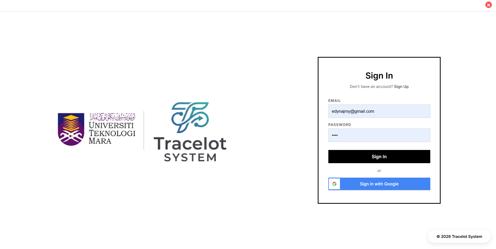
</p>

<p align="center">
  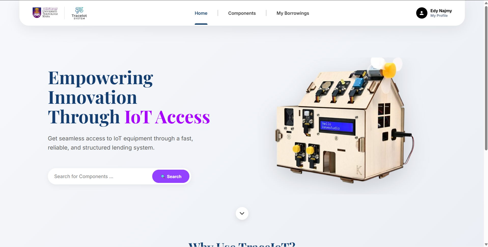
</p>

<p align="center">
  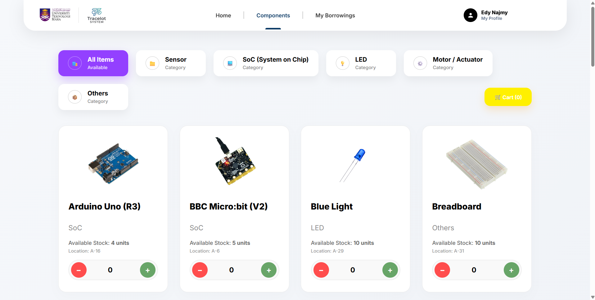
</p>

<p align="center">
  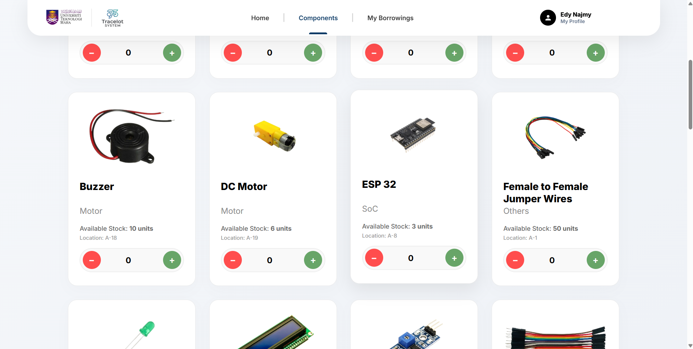
</p>

<p align="center">
  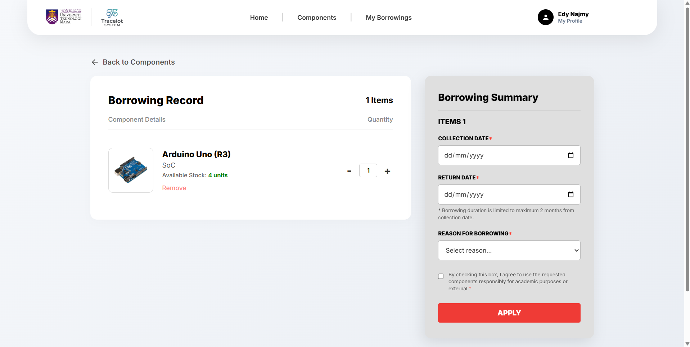
</p>

<p align="center">
  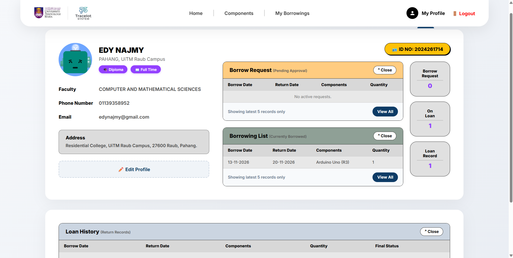
</p>

<p align="center">
  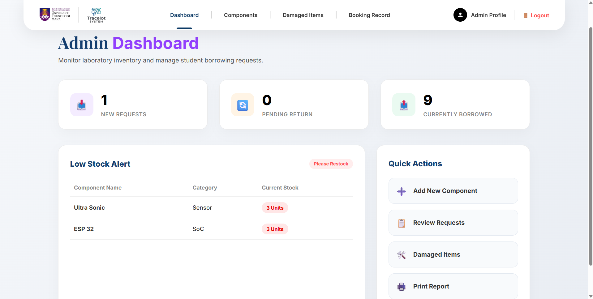
</p>

<p align="center">
  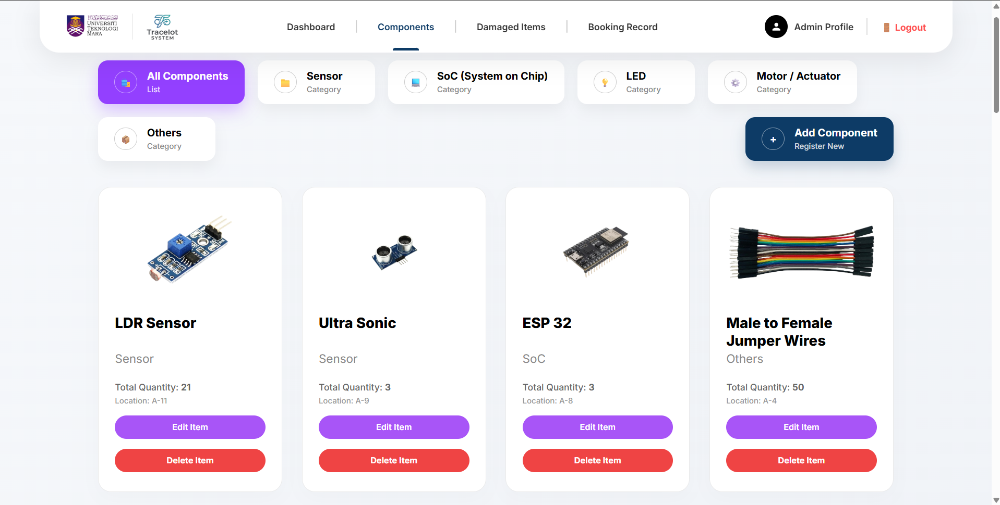
</p>

<p align="center">
  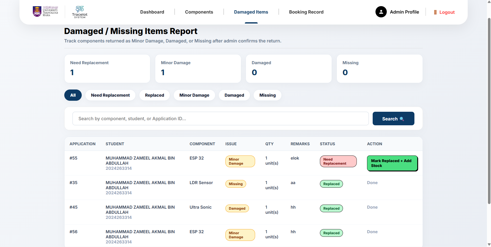
</p>

<p align="center">
  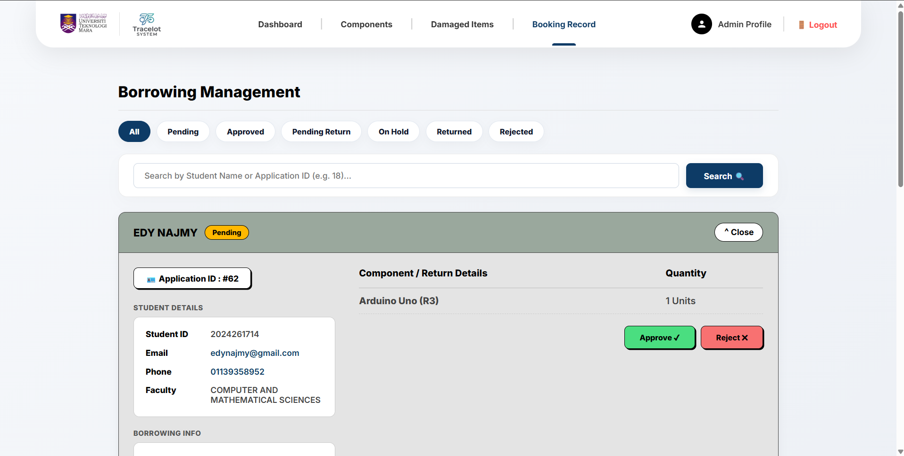
</p>

<p align="center">
  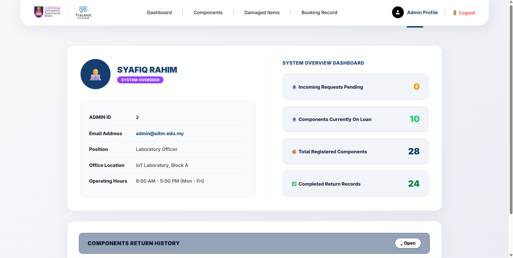
</p>

<p align="center">
  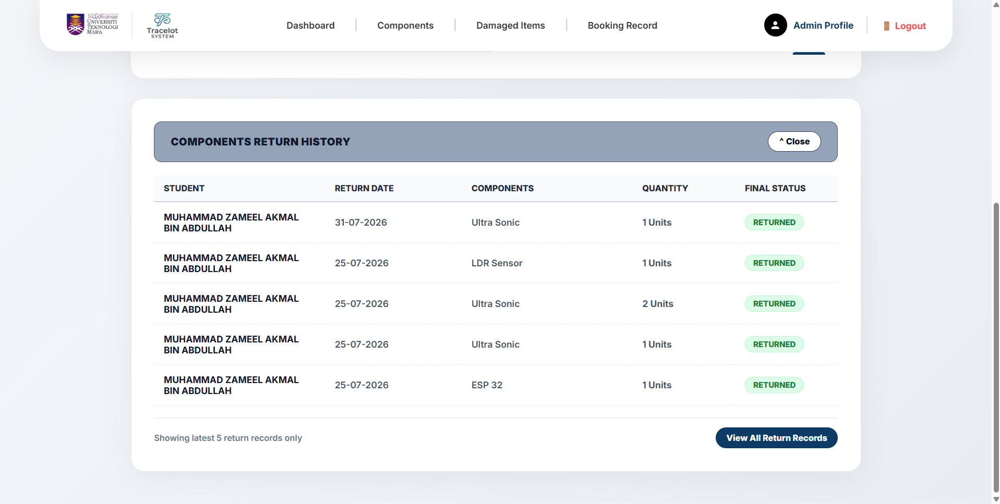
</p>

<p align="center">
  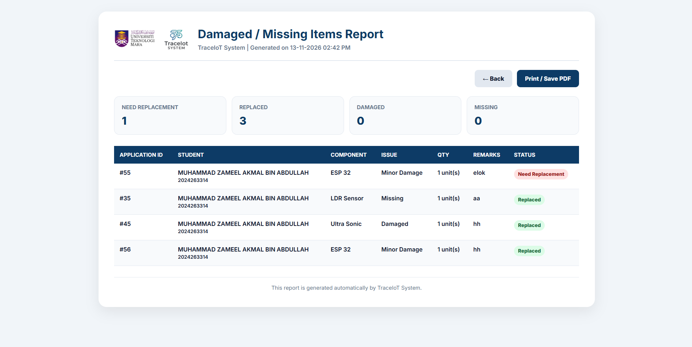
</p>

<p align="center">
  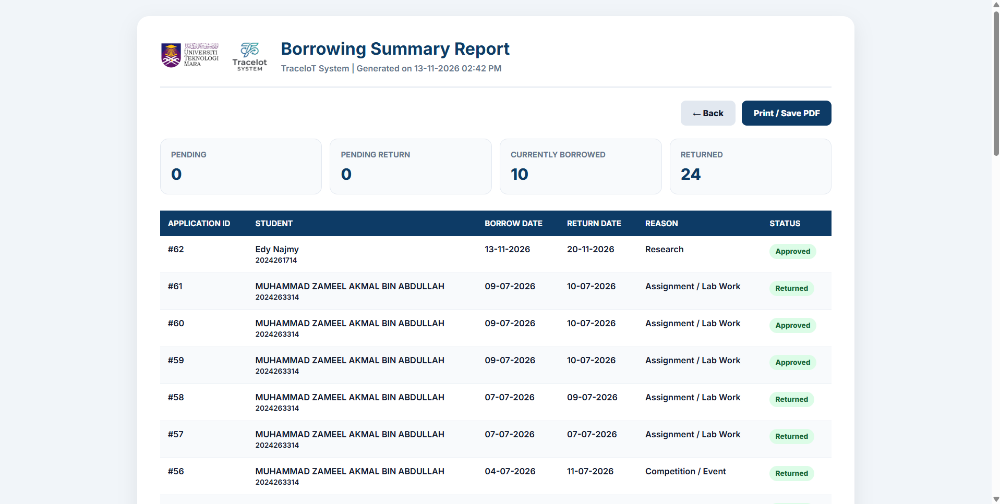
</p>

<p align="center">
  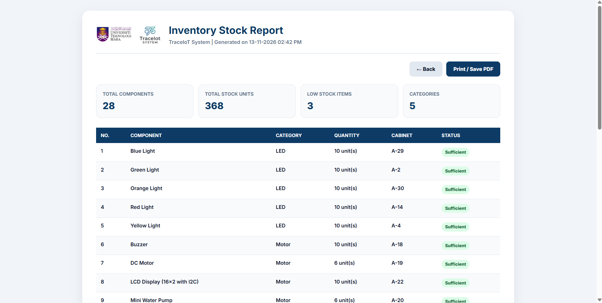
</p>

## Features

### Student
- Browse and search available IoT components.
- View component categories and stock availability.
- Submit component borrowing requests.
- Track borrowing application status.
- View current borrowings and borrowing history.
- Request component returns.
- View personal borrowing records.

### Administrator
- Manage IoT component inventory.
- Add and update component information.
- Review, approve, and reject borrowing requests.
- Monitor borrowed and returned components.
- Manage damaged and missing item reports.
- Monitor low-stock alerts.
- Generate and print inventory, borrowing, and damage reports.

## Technologies Used

- **Frontend:** HTML, CSS, JavaScript, Bootstrap
- **Backend:** PHP
- **Database:** MySQL
- **Libraries:** PHPMailer, Google API Client
- **Development Environment:** XAMPP

## Installation & Setup

1. Clone this repository:

   ```bash
   git clone https://github.com/YOUR-USERNAME/TraceIoT.git
   ```

2. Move the project folder into XAMPP's `htdocs` directory.

3. Start Apache and MySQL using the XAMPP Control Panel.

4. Create a MySQL database named:

   ```sql
   CREATE DATABASE traceiot_system;
   ```

5. Configure your database connection in `connection.php` according to your local MySQL settings.

6. Install PHP dependencies:

   ```bash
   composer install
   ```

7. Configure Google OAuth and email settings if you want to use these features. Use your own credentials and never commit private credentials to GitHub.

8. Open the application in your browser:

   ```text
   http://localhost/traceiot/
   ```

## Project Purpose

This project was developed as part of the CSC264 group project at Universiti Teknologi MARA (UiTM). It aims to improve inventory tracking, streamline borrowing procedures, and reduce manual record-keeping through a digital management platform.

## Security Notice

- Never upload passwords, API keys, OAuth secrets, or private credentials.
- Do not upload real student information or private documents.
- Configure your own database and authentication credentials.
- Use sample data when demonstrating the system.

## Author

**UiTM Raub CS Student 2026**

Project: TraceIoT – IoT Component Inventory & Borrowing Management System

